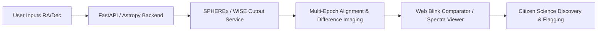

# 🛸 Team Command Center: SPHEREx Hunter
> **Team:** RIP | **Location:** Coimbatore, India
> **Challenge:** Planet X and SPHEREx | **Track:** Advanced Astrophysics / Web Tool

---

## 🌌 Mission Statement
NASA's **SPHEREx** mission is mapping the entire sky in **102 near-infrared bands** every 6 months, observing over **1 billion objects**. Our mission is to build **SPHEREx Hunter**: a high-performance, public-facing citizen science web application that allows anyone to query sky coordinates (RA & Dec), visualize temporal changes across epochs using an animated blink comparator, subtract images to isolate transients, inspect 102-band infrared spectral signatures, and spot moving asteroids, brown dwarfs, or candidate trans-Neptunian objects (Planet X).

---

## ⚡ Quick Links & Navigation

| Category | Key Documents | Description |
| :--- | :--- | :--- |
| **Mission & Spec** | [[01 - Challenge Deconstruction]] [[02 - Mandatory Test Targets & Benchmark Suite]] [[03 - SPHEREx Instrument & Data Primer]] | What NASA wants, target coordinates & instrument physics |
| **Team & Roles** | [[00 - Team Structure & Skill Matrix]] [[Role - Full-Stack Web Lead]] [[Role - Astro-Data & Backend Engineer]] [[Role - AI & Computer Vision Lead]] [[Role - UI-UX & Citizen Science Lead]] | Exact responsibilities, setup steps, and tasks for each teammate |
| **Technical Design**| [[01 - Architecture Overview]] [[02 - Tech Stack Justification]] [[03 - Image Processing & Blink Comparator Spec]] [[04 - API & URL Deep-Linking Specification]] | Frontend, backend, image math, Astropy pipelines & API contracts |
| **Execution** | [[01 - Project Roadmap & Milestones]] [[Master Kanban Taskboard]] [[Sprint Phase 1 - Hours 00 to 12 (Foundation & Ingestion)]] | 48-hour sprint phases, hourly schedule & checklists |
| **Final Pitch** | [[NASA Submission Requirements & Checklist]] [[Winning Project Pitch Deck Outline]] [[Demo Video Script & Storyboard (30-sec to 3-min)]] | Slide deck, GitHub repo criteria, demo video requirements |

---

## 🎯 Mandatory Benchmark Targets (Must Pass in Demo)
Every team member must verify our tool works for these 5 NASA-specified test targets:
- [ ] **Barnard's Star:** High proper motion nearby star ([[02 - Mandatory Test Targets & Benchmark Suite#1 Barnard's Star]])
- [ ] **Epsilon Indi B:** Brown dwarf binary orbiting a star ([[02 - Mandatory Test Targets & Benchmark Suite#2 Epsilon Indi B]])
- [ ] **WISE 0855:** Ultra-cool brown dwarf at `08h55m10.831s, -07°14'42.53"` ([[02 - Mandatory Test Targets & Benchmark Suite#3 WISE 0855]])
- [ ] **RW Aurigae:** Young eruptive variable star with fluctuating accretion disks ([[02 - Mandatory Test Targets & Benchmark Suite#4 RW Aurigae]])
- [ ] **R Draconis:** Long-period Mira variable pulsating red giant ([[02 - Mandatory Test Targets & Benchmark Suite#5 R Draconis]])

---

## ⏱️ Live Sprint Progress Monitor

> [!NOTE] Current Sprint Phase: **Phase 1 (Foundation & Core Ingestion)**
> Focus on setting up the repo, verifying Astropy/IRSA query scripts, and scaffolding the React/Vite blink comparator UI.

- [ ] **Phase 1 (Hours 00–12):** Environment, Data Pipeline, Aladin Lite / Canvas Prototype ([[Sprint Phase 1 - Hours 00 to 12 (Foundation & Ingestion)]])
- [ ] **Phase 2 (Hours 12–24):** Blink Comparator Engine, Multi-epoch Alignment, Difference Imaging ([[Sprint Phase 2 - Hours 12 to 24 (Blink Viewer & Image Math)]])
- [ ] **Phase 3 (Hours 24–36):** 102-Band Spectra Viewer, Multi-survey Overlays, URL Query params ([[Sprint Phase 3 - Hours 24 to 36 (Spectra, Overlays & AI Flagging)]])
- [ ] **Phase 4 (Hours 36–48):** Testing 5 Benchmark Targets, Demo Video, GitHub Polish, NASA Space Apps Portal Submission ([[Sprint Phase 4 - Hours 36 to 48 (Testing, Polish & Submission)]])

---

## 📢 Team Standup Board & Decisions
- **Standup 1 (Hour 06):** Check Astropy cutout service on WISE 0855 & frontend coordinate input bar.
- **Standup 2 (Hour 18):** Test blink animation speed slider and image subtraction toggle.
- **Standup 3 (Hour 30):** Verify 102-band spectral plot generation and Gaia/WISE overlay toggle.
- **Standup 4 (Hour 42):** Final video recording freeze, slide deck export, and submission check.
