# ⏱️ Project Roadmap & 48-Hour Hackathon Milestones
> **Sprint Strategy:** Fast MVP -> Robust Astronomy Math -> Polish & Video Presentation.

```mermaid
gantt
    title 48-Hour Hackathon Sprint Schedule
    dateFormat X
    axisFormat Hour %s
    section Phase 1: Setup & Data
    Repo Setup & Dev Environment        :active, p1_1, 0, 4
    Astropy / SPHEREx / WISE Pipeline    :p1_2, 2, 10
    Frontend Scaffolding & Aladin Canvas:p1_3, 4, 12
    section Phase 2: Core Engine
    Blink Animation & Player Controls   :p2_1, 12, 18
    Multi-Epoch Registration & Diff Img :p2_2, 14, 22
    URL Query Parameter Deep-Linking    :p2_3, 18, 24
    section Phase 3: Advanced Features
    102-Band Co-addition & Spectra Plot :p3_1, 24, 32
    Multi-Survey Overlays (Gaia/WISE)   :p3_2, 26, 34
    Candidate Flagging & Export System  :p3_3, 30, 36
    section Phase 4: Polish & Submit
    5 Benchmark Targets Verification    :p4_1, 36, 40
    Demo Video Recording & Voiceover    :p4_2, 38, 44
    Submission Form, GitHub Readme, PRs :p4_3, 42, 48
```

---

## 🏆 Key Milestones

### 🏁 Milestone 1: Data Ingestion & Coordinate Resolver (Hour 10)
- **Goal:** Enter coordinates `08h55m10.831s, -07d14m42.53s` (or decimal degrees) and fetch real astronomical multi-epoch cutouts within 2 seconds.
- **Owner:** [[Role - Astro-Data & Backend Engineer]] & [[Role - Full-Stack Web Lead]]
- **Exit Criteria:** Backend returns a JSON payload containing signed URLs or base64 images of 2+ epochs with correct WCS coordinates.

### 🏁 Milestone 2: Functional Blink Comparator & Image Math (Hour 22)
- **Goal:** Interactive web canvas playing epoch 1, epoch 2, epoch N in a loop at adjustable frame rates (1 to 10 FPS) with image subtraction toggle.
- **Owner:** [[Role - Full-Stack Web Lead]] & [[Role - AI & Computer Vision Lead]]
- **Exit Criteria:** Users clearly see WISE 0855 move against background stars!

### 🏁 Milestone 3: 102-Band Spectra & Multi-Survey Overlay (Hour 34)
- **Goal:** Co-add 6 detector arrays to boost SNR and click any pixel to render a spectral energy distribution (SED) from 0.75 μm to 5.0 μm.
- **Owner:** [[Role - Astro-Data & Backend Engineer]] & [[Role - UI-UX & Citizen Science Lead]]
- **Exit Criteria:** Interactive spectrum chart with identifiable molecular absorption bands ($H_2O, CO, CO_2, CH_4$).

### 🏁 Milestone 4: Code Freeze & NASA Space Apps Submission (Hour 44)
- **Goal:** Public web app deployed on Vercel/Render, demo video uploaded to YouTube, GitHub repository documented with clear instructions, and NASA Space Apps submission page finalized.
- **Owner:** Entire Team RIP
- **Exit Criteria:** All 5 mandatory test targets validated and documented in project pitch.
