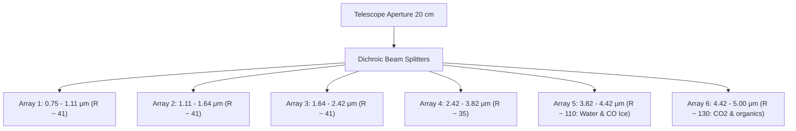

# 🛰️ SPHEREx Instrument & Data Primer
> **Mission Background:** NASA Astrophysics Medium-Class Explorer (MIDEX)
> **Launch:** May 2025 | **Orbit:** Low-Earth Sun-Synchronous Polar (600 km)
> **Primary Science Goals:** Cosmic Inflation, Galaxy Formation (Epoch of Reionization), and Origin of Water/Biogenic Ices.

---

## 1. Instrument Optics & Detectors

SPHEREx does not use a dispersive slit or grism; instead, it uses **Linear Variable Filters (LVFs)** mounted directly over **six Hawaii-2RG (H2RG) $2048 	imes 2048$ pixel mercury-cadmium-telluride (HgCdTe) arrays**.

### Key Optical Specs:
- **Pixel Scale:** $6.2	ext{ arcsec}/	ext{pixel}$ (large field of view, ideal for wide-area all-sky scanning).
- **Instantaneous Field of View:** $3.5^\circ 	imes 11.3^\circ$.
- **Spectral Coverage:** $0.75\ \mu	ext{m}$ to $5.0\ \mu	ext{m}$ divided into **102 distinct spectral channels**.
- **Cadence:** Maps the entire sky every **6 months** (4 complete all-sky maps over 2-year nominal mission).

---

## 2. Why SPHEREx is Uniquely Suited for "Planet X" & Brown Dwarfs
1. **Cold Object Sensitivity ($T < 300	ext{ K}$):**
   - Cold brown dwarfs (like WISE 0855) and hypothetical outer planets have blackbody peaks in the mid-infrared ($3.0 - 5.0\ \mu	ext{m}$).
   - Optical surveys (like Hubble or Gaia) are completely blind to them. SPHEREx Arrays 4, 5, and 6 are directly in this thermal emission sweet spot.
2. **Molecular Spectroscopy:**
   - SPHEREx detects $H_2O$ ice ($3.05\ \mu	ext{m}$), $CO_2$ ice ($4.27\ \mu	ext{m}$), and $CO$ ($4.67\ \mu	ext{m}$) absorption features. If a moving target has methane ($CH_4$) or water vapor absorption, it is immediately confirmed as a cold substellar object!

---

## 3. Data Products & Ingestion
SPHEREx data is archived at the **NASA/IPAC Infrared Science Archive (IRSA)**:
- **Level 2 (Calibrated Spectral Images):** Single-exposure images in FITS format with WCS coordinates and error arrays.
- **Level 3 (Spectral Coadds):** Reconstructed spectral sky tiles over epochs.
- **Color Representation in our Web App:**
  - Since human eyes cannot see near-infrared, we map the 6 detector arrays into intuitive RGB channels:
    - **Blue Channel:** Array 1 & 2 ($0.75 - 1.64\ \mu	ext{m}$ - Stellar continuum)
    - **Green Channel:** Array 3 & 4 ($1.64 - 3.82\ \mu	ext{m}$ - Intermediate / hot dust)
    - **Red Channel:** Array 5 & 6 ($3.82 - 5.00\ \mu	ext{m}$ - Cold objects, brown dwarfs, Planet X candidates)
