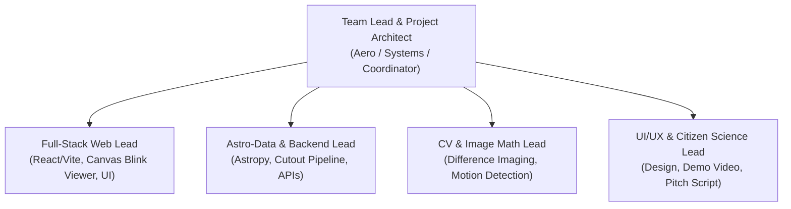

# 👥 Team Structure & Skill Matrix
> **Team:** RIP (Coimbatore, India)
> **Core Background:** Aeronautical Engineering, Aerospace Propulsion, CFD, Python, Simulation, CAD, Automation & R&D.

---

## 🌟 Translating Engineering & Aero Skills to NASA Space Apps
As aeronautical engineering students skilled in **Python, simulation, CAD, and CFD**, our engineering toolkit maps directly into astrophysics software:

| Your Aero / Engineering Skill | Space Apps Equivalent | Why You Have an Edge |
| :--- | :--- | :--- |
| **Python & Scientific Computing (NumPy, SciPy)** | Astropy, Astroquery, FITS processing | You understand tensor operations, spatial grids, and mathematical transformations. |
| **CFD & Grid Discretization (ANSYS, Meshing)** | Astronomical WCS (World Coordinate System) & Pixel Projection | Moving between coordinate frames (Cartesian to Spherical RA/Dec) is standard mesh kinematics. |
| **CAD & 3D Visualization (SolidWorks, CATIA)** | WebGL / Three.js astronomical canvas & 3D Celestial Sphere | You have strong spatial intuition and UI comprehension of 3D vectors. |
| **Aerospace Systems & R&D Mindset** | NASA Mission Architecture & Rigorous Benchmarks | You respect technical specifications, error budgets, and mission verification checklists. |

---

## 🛠️ Role Allocations & Ownership

### Detailed Role Profiles:
1. [[Role - Full-Stack Web Lead]]
   - Owns: Frontend application, coordinate input, canvas blink engine, frame-rate controls, URL query params.
2. [[Role - Astro-Data & Backend Engineer]]
   - Owns: Astropy cutout service, SPHEREx/WISE/Gaia data queries, FITS-to-PNG caching, 102-band spectral generator.
3. [[Role - AI & Computer Vision Lead]]
   - Owns: Image co-addition, sub-pixel alignment, difference imaging ($I_{t2} - I_{t1}$), automated candidate motion flagging.
4. [[Role - UI-UX & Citizen Science Lead]]
   - Owns: NASA-styled interface, Backyard Worlds citizen-science workflow, demo video, pitch presentation slides.
