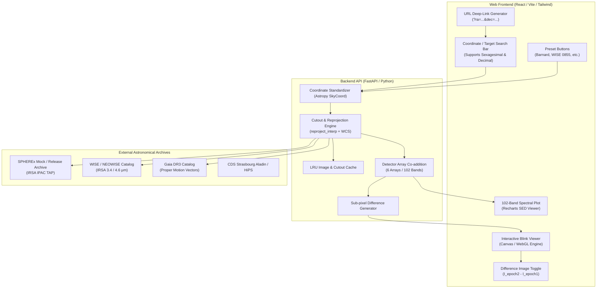

# 🏗️ System Architecture Overview
> **Project:** SPHEREx Hunter - Time-Domain Infrared Sky Browser

---

## 🔄 Core Data Flow
1. **Input Phase:** The user enters coordinates or clicks a preset button.
2. **Resolution Phase:** Astropy standardizes the input to ICRS degrees and queries available epoch tiles.
3. **Processing Phase:** Backend reprojects images to a uniform pixel grid, applies Asinh/ZScale stretch, and calculates image difference.
4. **Rendering Phase:** Frontend receives optimized epoch PNGs and renders them at 1-10 FPS with interactive controls.
5. **Deep Dive Phase:** Clicking any pixel queries the 102-channel flux array, graphing the object's infrared SED.
