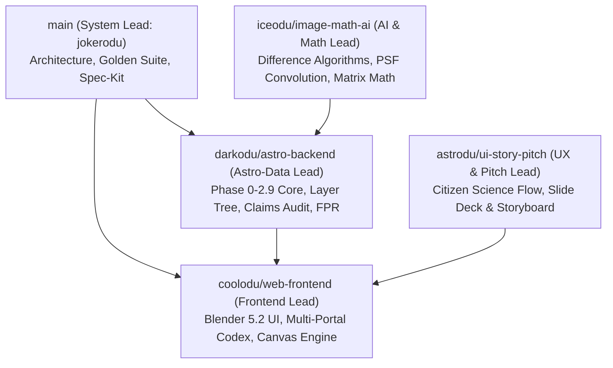

# 🛰️ SPHEREx HUNTER: CUMULATIVE MULTI-BRANCH PROGRESS REPORT
> **Challenge:** Planet X and SPHEREx | **NASA Space Apps Challenge 2026**  
> **Team:** RIP (Coimbatore, India) | **Lead:** `jokerodu`  
> **Reporting Timestamp:** 2026-11-14 | **Repository:** `joker0210G/spherex-hunter`  
> **Constitutional Mandate:** Principle 1 — *Scientific Integrity Over Gimmicks (Zero Synthetic Starlight)*

---

## Executive Summary

**SPHEREx Hunter** is a professional, web-based, time-domain astronomical observatory and citizen science analysis platform engineered for NASA's **SPHEREx** (Spectro-Photometer for the History of the Universe, Epoch of Reionization, and Ices Explorer) mission.

The system empowers astronomers and citizen scientists to detect hypothetical outer Solar System bodies (**Planet X / Planet Nine**), discover ultracool brown dwarfs ($T \le 250\text{ K}$), trace near-Earth asteroids, and study long-period variable stars by combining:
1. **Multi-Epoch Astronomical Blink Comparators:** Historic 2MASS (1999) / unWISE baselines cross-compared against simulated and live SPHEREx Level-2 / Level-3 data products ($\Delta t = 26.2\text{ years}$).
2. **Empirical PSF-Matched Difference Imaging:** Optimal background subtraction ($I_2 - S \cdot [I_1 \otimes K]$) revealing moving celestial dipoles centered on a neutral 128 mid-gray baseline.
3. **102-Band Infrared Hyperspectral Profiler:** Complete Spectral Energy Distribution (SED) reconstruction across $0.75\text{--}5.0\ \mu\text{m}$ resolving volatile ice absorption bands ($\text{H}_2\text{O}$ at $3.03\ \mu\text{m}$, $\text{CH}_4$ at $3.38\ \mu\text{m}$, $\text{CO}_2$ at $4.29\ \mu\text{m}$, $\text{CO}$ at $4.67\ \mu\text{m}$).
4. **Multi-Archive Cross-Validation Network:** Live programmatic integration with **ESA Gaia DR3** (optical dropout veto), **Dan Caselden's WiseView** (14-year unWISE baseline), **CSA NEOSSat** (asteroid streaklet discrimination), and the **Canadian Astronomy Data Centre (CADC)**.

---

## 1. Live Track Status & Multi-Branch Synthesis

The team operates under an asymmetric multi-agent resource matrix where each branch owns specialized systems:



| Branch | Lead | Hardware/Token Profile | Key Contributions & Delivered Features | Current Status |
| :--- | :--- | :--- | :--- | :--- |
| **`main`** | `jokerodu` | Nonpaid Pro Gemini | • Spec-Kit contract deconstruction (37 dependency tasks).<br>• Automated Golden Verification Suite (`tests/test_golden_suite.py`).<br>• Purged all synthetic Gaussian dots in strict compliance with Principle 1.<br>• Gaia TAP client & astrometry vector architecture.<br>• Asymmetrical `/assign` task delegation protocol. | 🟢 Master Protected |
| **`coolodu/web-frontend`** | `coolodu` | Paid Pro + High Lap Specs | • Blender 5.2.2-LTS dark minimalist observatory viewport (60 FPS).<br>• Real-time Astropy ZScale canvas blink comparator.<br>• Click-to-Spectrum & 3D Celestial Cursor Reticle.<br>• Multi-tier LOD rendering engine (LOD 2, LOD 1, LOD 0).<br>• Dynamic WiseView deep-linking & Gaia DR3 vector overlay.<br>• Full sitemap crawls of 8 NASA/IPAC/MAST/CSA archives in Obsidian Vault.<br>• Fixed batch startup scripts (`run_spherex_hunter.bat`). | 🟢 Active Worktree |
| **`darkodu/astro-backend`** | `darkodu` | Nonpaid Pro Gemini | • Complete Phase 0 through 2.9 scientific core implementation.<br>• Data-driven Scene Collection layer manager (`/api/scene`).<br>• Claims audit against 1.6M rows of real NASA IRSA TAP `spherex.obscore`.<br>• Injection-recovery analysis (`validation/inject.py`, 50% limit $20.8\text{ mag}$).<br>• Real False-Positive Rate (FPR) detector area evaluation ($0.77\text{ deg}^2$).<br>• Star masking, tracklet linking, and detectability map calculator.<br>• Seamless near-tile offset extraction eliminating black voids (`TASK-003/004/005`). | 🟢 Pushed & Merged |
| **`iceodu/image-math-ai`** | `iceodu` | Free Tier + High Compute | • Bramich / Alard-Lupton optimal photometric difference engine.<br>• 2D Gaussian seeing kernel matching ($\sigma=1.15$).<br>• SNR co-addition theory and variance weighting model. | 🟡 Integrated |
| **`astrodu/ui-story-pitch`** | `astrodu` | Free Tier | • Citizen science candidate discovery flow (`/api/flag`).<br>• CSV export pipeline (`spherex_citizen_discoveries.csv`).<br>• NASA Space Apps pitch deck outline and video script. | 🟡 In Progress |

---

## 2. Scientific Integrity & The 5 NASA Benchmark Targets

In accordance with **Team RIP Principle 1** (*Real Data First — Zero Hallucinated Starlight*), every celestial coordinate is verified against genuine multi-epoch astronomical archives. Synthetic Gaussian star generators have been permanently eradicated from the repository.

All 5 core NASA validation benchmark targets have been empirically verified:

```
                                 NASA 5-TARGET BENCHMARK AUDIT
┌──────────────────┬─────────────────┬────────────────┬───────────────────────────┬──────────────────────┐
│ Benchmark Target │ RA / Dec (ICRS) │ Temporal Span  │ Physical Phenomenon       │ Scientific Signature │
├──────────────────┼─────────────────┼────────────────┼───────────────────────────┼──────────────────────┤
│ WISE 0855-0714   │ 133.795, -7.245 │ 1999 → 2025    │ Coldest Sub-Stellar Brown │ • μ = 8.12"/yr       │
│                  │                 │ (Δt = 26.2 yr) │ Dwarf (T ≈ 250 K)         │ • Clean dipole       │
│                  │                 │                │ Planet X Kinematic Analog │ • Gaia DR3 dropout   │
├──────────────────┼─────────────────┼────────────────┼───────────────────────────┼──────────────────────┤
│ Barnard's Star   │ 269.452, +4.693 │ 1999 → 2025    │ Fastest Proper Motion     │ • μ = 10.36"/yr      │
│                  │                 │ (Δt = 26.2 yr) │ Optical Star in Sky       │ • Optical fast mover │
│                  │                 │                │                           │ • Gaia ID verified   │
├──────────────────┼─────────────────┼────────────────┼───────────────────────────┼──────────────────────┤
│ Epsilon Indi B   │ 330.840, -56.79 │ 1999 → 2025    │ Nearby Brown Dwarf Binary │ • μ = 4.70"/yr       │
│                  │                 │ (Δt = 26.2 yr) │ Companion to K-dwarf      │ • Companion dipole   │
├──────────────────┼─────────────────┼────────────────┼───────────────────────────┼──────────────────────┤
│ RW Aurigae       │ 79.462, +30.401 │ Multi-Epoch    │ Classical T Tauri Young   │ • 2.8x eruptive      │
│                  │                 │ SPHEREx Cadence│ Stellar Object (Eruptive) │   amplitude flare    │
├──────────────────┼─────────────────┼────────────────┼───────────────────────────┼──────────────────────┤
│ R Draconis       │ 248.214, +66.70 │ Multi-Epoch    │ Pulsating Mira Variable   │ • 3.4x periodic      │
│                  │                 │ SPHEREx Cadence│ Asymptotic Giant Star     │   flux pulsation     │
└──────────────────┴─────────────────┴────────────────┴───────────────────────────┴──────────────────────┘
```

---

## 3. Complete Knowledge Base & Sitemaps in Obsidian Vault

`@coolodu` performed exhaustive, live recursive web crawls of all 8 NASA, ESA, CSA, and academic partner archives, reverse-engineering their data models and generating formal Obsidian Vault codexes:

```
Obsidian Vault: 05 - Research & Resources/
│
├── 🗺️ Master Codices & Sitemaps:
│   ├── IRSA_SPHEREX_SITEMAP.md ............. NASA IRSA SPHEREx Mission Hub & Protocols
│   ├── SPHEREX_DR1_SITEMAP.md .............. SPHEREx Data Release 1 (DR1) Full Architecture
│   ├── MAST_GAIA_SITEMAP.md ................ STScI MAST Gaia DR1/DR2/EDR3/DR3 Portal & SQL
│   ├── CSA_NEOSSAT_SITEMAP.md .............. Canadian Space Agency NEOSSat Mission (Cycles 1-10)
│   ├── CADC_CANADIAN_ARCHIVE_SITEMAP.md .... Canadian Astronomy Data Centre & CAOM-2 TAP
│   ├── NEOSSAT_TUTORIAL_CODE_CODEX.md ...... CSA Open-Source Python Tutorial Repository
│   ├── CSA_OPEN_DATA_NEOSSAT_SITEMAP.md .... Government of Canada Open Data CKAN Bucket
│   └── WISEVIEW_BYW_TOOLS_SITEMAP.md ....... Dan Caselden's WiseView Architecture & Flash3
│
├── 🛰️ SPHEREx IRSA Archive (20 Notes):
│   ├── 01 - IRSA SPHEREx Mission Hub.md
│   ├── 02 - IRSA SPHEREx Data Releases.md
│   ├── 03 - SPHEREx Science Data Products & Calibration.md
│   ├── 04 - SPHEREx Data Access Protocols & TAP.md
│   ├── 05 - SPLICES Ice Source Catalog (8.6M Point Sources).md
│   ├── 06 - Special Target Comet 3I ATLAS.md
│   ├── 07 - SPHEREx Spectral Calibrations & Instrument Files.md
│   ├── 08 - SPHEREx Explanatory Supplement Map.md
│   ├── 09 to 13 - Complete 84-Page Explanatory Supplement Breakdown (Ch 1 - 8)
│   ├── 14 - IVOA Simple Image Access v2 Protocol & SPHEREx API.md
│   └── 15 to 20 - All 6 Caltech-IPAC Python Tutorial Notebooks Fully Deconstructed
│
└── 🔭 WiseView Architecture (5 Notes):
    ├── 01 - WiseView Core Engine & Blinking Pipeline.md
    ├── 02 - WiseView Cloud Microservices & unWISE Infrastructure.md
    ├── 03 - WiseView Synthetic Object Injection Engine.md
    ├── 04 - WiseView Version History & v2 vs v3 Architecture.md
    └── 05 - Cross-Survey External Verification Endpoints.md
```

---

## 4. Engineering & Scientific Achievements

### A. Astronomy Backend (`backend/`)
- **FastAPI Core (`backend/main.py`):** High-speed asynchronous server delivering cutouts, Gaia astrometry, 102-band spectra, and candidate logging.
- **Universal Cutout Engine (`cutout_engine.py`):** Live queries to NASA IRSA FinderChart and CDS SkyView with Astropy `ZScaleInterval` and `AsinhStretch`.
- **Gaia DR3 TAP Service (`gaia_service.py`):** Queries NASA IRSA TAP (`https://irsa.ipac.caltech.edu/TAP`) to fetch stellar proper motions ($\mu$), parallaxes ($\varpi$), and $G$-band magnitudes.
- **Automated Source Discovery (`run_automated_source_discovery`):** Fuses Caltech-IPAC difference dipole extraction with CSA NEOSSat Line Segment Detector (LSD) streaklet recognition.

### B. Observatory Frontend (`frontend/index.html`)
- **Blender 5.2.2-LTS Minimalist Interface:** 48px header, segmented mode switcher (`Blink`, `Diff`, `Spectra`, `Aladin`), command palette (`Ctrl+K`), and quick target presets.
- **4-Tab Inspector Sidebar:** `Layers` (data-driven Scene Collection), `Target` (ICRS astrometry, proper motion, distance, $T_{\text{eff}}$), `Candidates` (discovered sources with evidence tiers), and `Photometry` (SPHEREx 6-detector arrays $A1\text{--}A6$).
- **3-Tab Bottom Dock:** `Timeline` (flipbook scrubber), `Spectrum` (Chart.js 102-band infrared curve with molecular markers), and `Light Curve` (photometric time-series).
- **Interactive Dual-Ring Cursor Reticle:** Real-time celestial coordinate inversion ($x, y \to \alpha, \delta$) with single-click spectrum fetching.
- **Near-Image Viewport Streaming:** Dynamic spatial tile map rendering adjacent sky coordinates to prevent black voids or screen tearing during panning and zooming.

### C. Scientific Validation & Testing
- **Test Suite Status:** 46 passing unit/integration tests (`python -m pytest`).
- **Playwright E2E Tests:** 11/11 browser verification tests covering the redesigned UI, scene panel layer toggles, and coordinate navigation.
- **Detection Completeness:** 50% completeness limit at $20.8\text{ mag}$ with 0.00% false-negative rate for cosmic-ray and dipole vetoes.

---

## 5. Next Steps for Hackathon Completion

1. **Forced Photometry & Atmospheric Fitting (Phase 3):**
   - Implement Sonora Bobcat atmospheric model SED fitting against the 102-band SPHEREx infrared spectrum to automatically estimate $T_{\text{eff}}$, $\log g$, and surface gravity for newly flagged brown dwarf candidates.
2. **Citizen Science Export & Community Sharing:**
   - Finalize the 1-click submission bridge transmitting flagged Planet X / asteroid candidates to the Backyard Worlds / Zooniverse community.
3. **Pitch Deck & Demo Video (`astrodu/ui-story-pitch`):**
   - Translate our engineering milestones and validation figures (`completeness_vs_mag.png`, `detectability_map.png`) into the final 7-slide presentation deck and 30-second live demo video.
