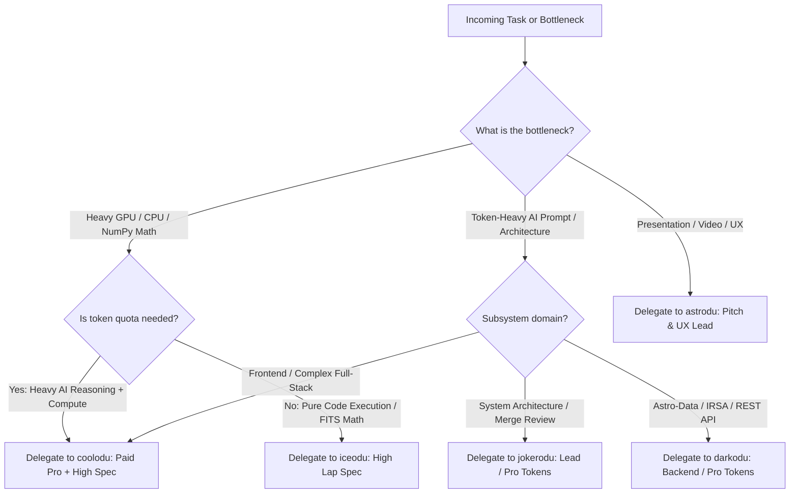

# ⚡ Team RIP: Hardware & AI Token Resource Matrix
> **NASA Space Apps Challenge 2026** | **Team:** RIP (Coimbatore, India)  
> **Challenge:** Planet X and SPHEREx | **System Architecture:** Asymmetrical Compute & Token Delegation

---

## 📊 Teammate Capabilities & Resource Distribution

This matrix establishes the operational profiles of each team member so that tasks are automatically delegated to teammates with the highest capability in that domain:

| Teammate | AI Token Tier | Hardware Specs | Owned Branch | Primary Strengths | Optimal Tasks to Forward to Them |
| :--- | :--- | :--- | :--- | :--- | :--- |
| **`coolodu`** | **Paid Pro Gemini** (High Token Cap) | **High Lap Specs** (Multi-core CPU, Dedicated GPU, 16+ GB RAM) | `coolodu/web-frontend` | Full-stack Web, Three.js/Canvas, Heavy AI Prompts, Heavy Compute | **Top Powerhouse Node:** Forward large architectural refactors, complex multi-file coding, heavy UI rendering, and token-hungry agent reasoning. |
| **`iceodu`** | **Free Tier** (Limited Token Cap) | **High Lap Specs** (Powerful CPU/GPU, Large RAM) | `iceodu/image-math-ai` | Scientific Python, NumPy/SciPy, PSF Convolution, Heavy Image Math | **Compute Engine Worker:** Forward heavy local math, Alard-Lupton PSF convolutions, batch FITS matrix reductions, and local rendering. *(Offloads big AI prompt tasks to `coolodu`, `jokerodu`, or `darkodu`)*. |
| **`jokerodu`** | **Nonpaid Pro Gemini** (Pro Token Cap) | Medium Specs (Standard CPU/RAM) | `main` | Team Lead, Systems Architecture, Astrodynamics, Git Master | **Lead Architect & Coordinator:** Forward system-level decisions, complex cross-subsystem debugging, API contract validation, and master branch merge reviews. |
| **`darkodu`** | **Nonpaid Pro Gemini** (Pro Token Cap) | Medium Specs (Standard CPU/RAM) | `darkodu/astro-backend` | Astrophysics Pipelines, Astroquery, TAP Archives, FastAPI Backend | **Astro-Data Lead:** Forward remote NASA IRSA / SkyView archive queries, 102-band infrared SED spectrum generation, and backend API routes. |
| **`astrodu`** | Free Tier (Standard Token Cap) | Standard Specs (Standard Laptop) | `astrodu/ui-story-pitch` | UI/UX Storyboarding, Citizen Science UX, Video Pitch, Slide Deck | **Story & Pitch Lead:** Owns presentation deck and user experience. *(Offloads heavy 3D rendering to `coolodu`/`iceodu` and heavy prompt generation to Pro token peers)*. |

---

## 🔄 Task Routing Heuristics



---

## 📜 Team Work Delegation Rules

1. **Never Let a Teammate Stall on Token Limits:**
   If `iceodu` or `astrodu` hit free-tier rate limits, their Antigravity agent or teammate immediately runs:
   ```bash
   python tools/task_forwarder.py dispatch --to coolodu --type token_heavy --title "Task Title" --brief "Task Brief..."
   ```
2. **Never Let a Lightweight Laptop Thermal Throttle:**
   If `jokerodu`, `darkodu`, or `astrodu` need to run massive batch FITS reductions or 100+ epoch image convolutions, they offload the compute to `iceodu` or `coolodu`:
   ```bash
   python tools/task_forwarder.py dispatch --to iceodu --type compute_heavy --title "Batch FITS Reduction" --brief "..."
   ```
3. **Always Check Inbox on `git pull`:**
   Teammates run `python tools/task_forwarder.py check` or let their Antigravity co-pilot check `07 - Team Memory & Sync/TASK_DISPATCH/inbox/` at session startup.
