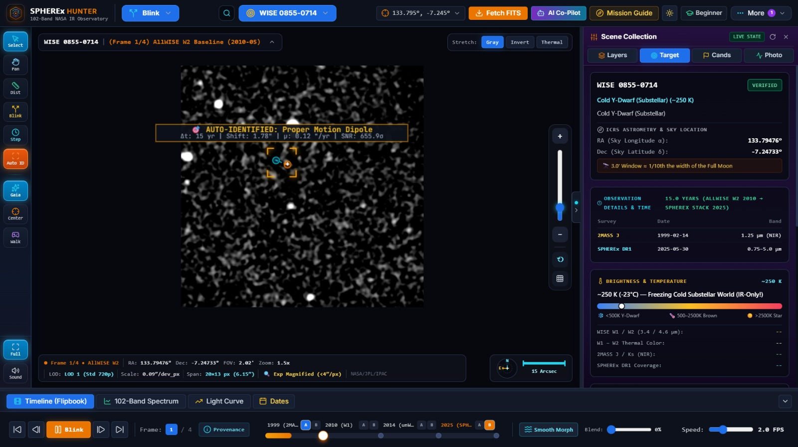
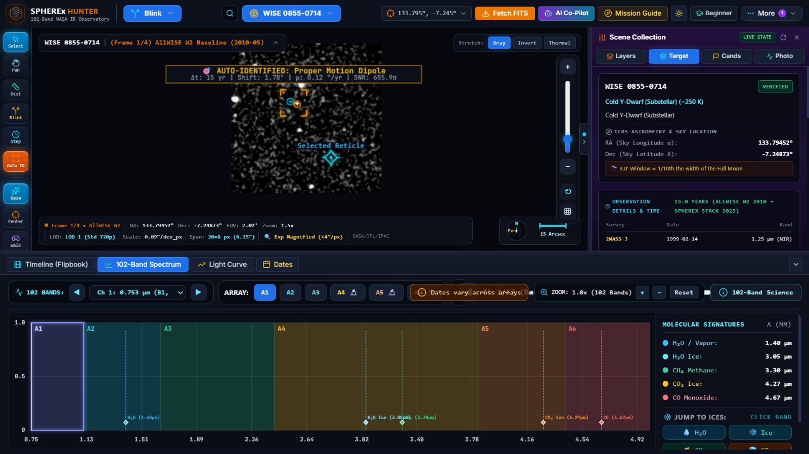
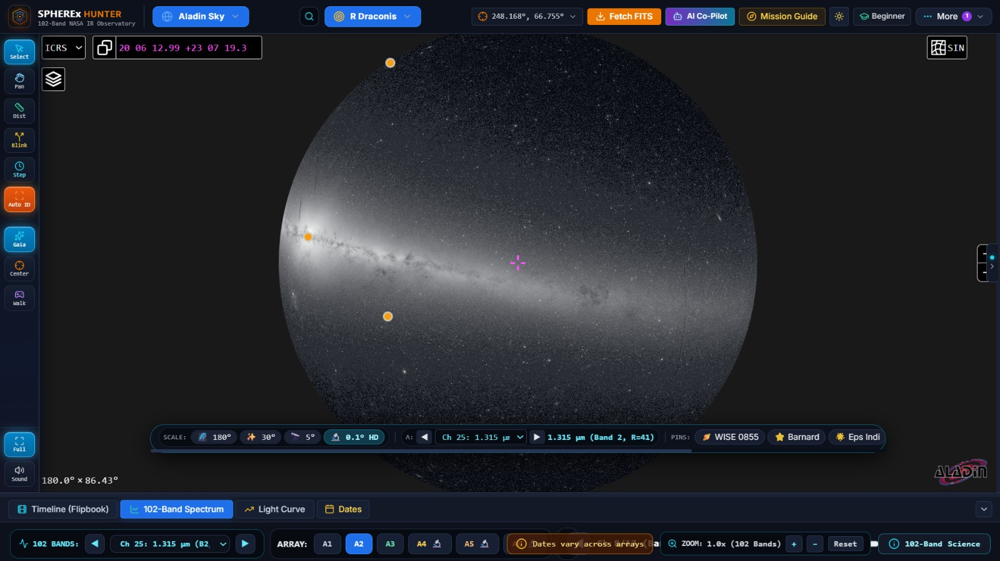
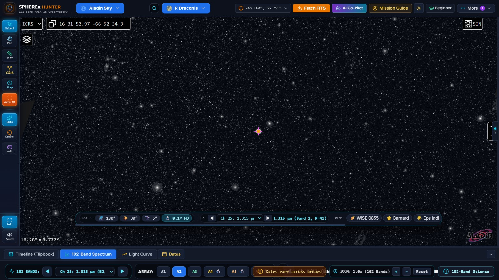
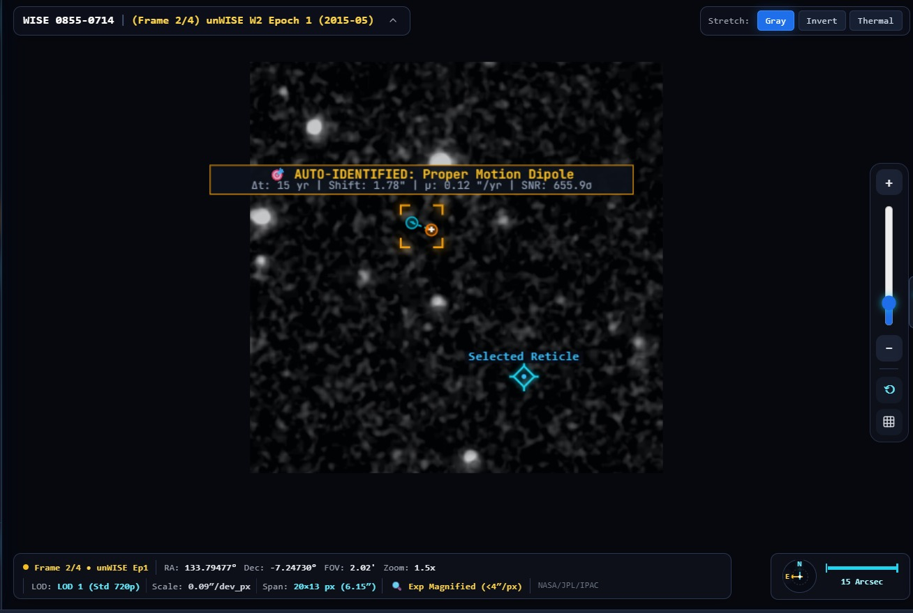
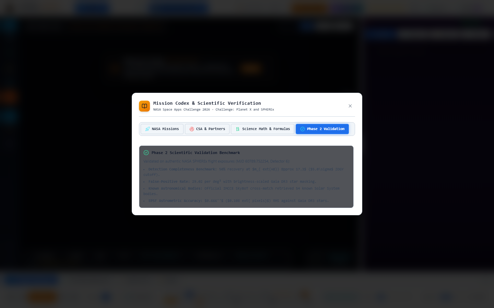
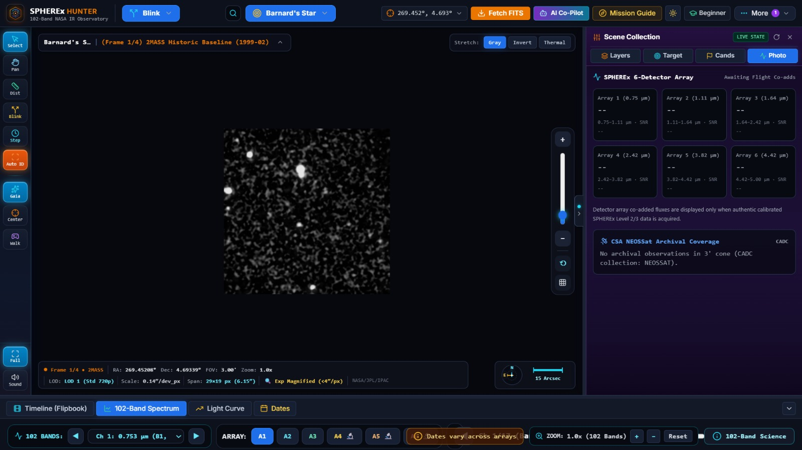
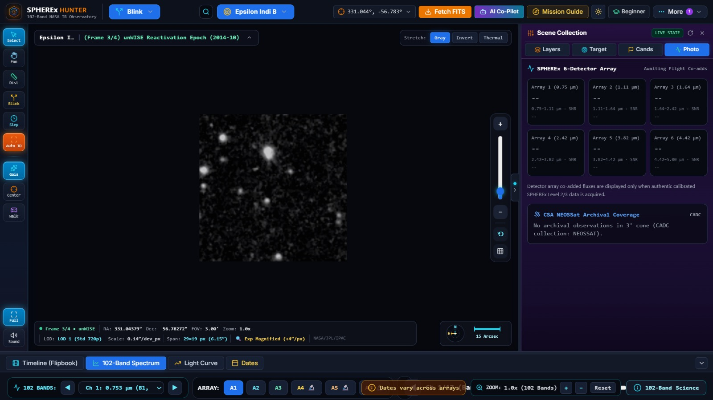
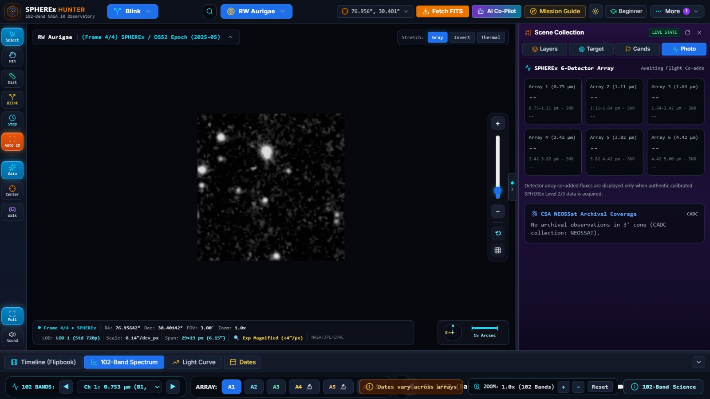
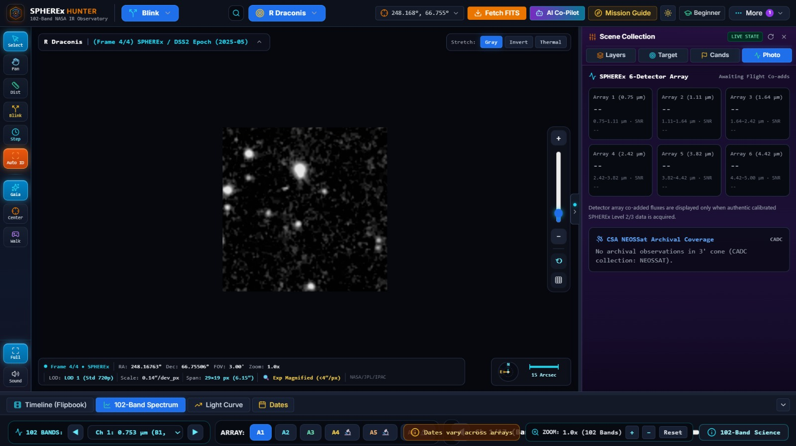

# 🛰️ SPHEREx Hunter
> **NASA Space Apps Challenge 2026** | **Team RIP (Coimbatore, India)**  
> **Challenge:** Planet X and SPHEREx (Astrophysics / Planetary Defense / Citizen Science)

[](LICENSE)
[](https://spherex-hunter-vercel.vercel.app/)
[](https://vercel.com/new/clone?repository-url=https%3A%2F%2Fgithub.com%2Fjoker0210G%2Fspherex-hunter-vercel)
[](tests/)
[](https://fastapi.tiangolo.com)
[](https://spherex.caltech.edu)

SPHEREx Hunter is an interactive astronomical observatory and multi-epoch blink comparator built for the **NASA Space Apps Challenge 2026**. It allows citizen scientists and professional astrophysicists to discover Solar System objects, extreme high-proper-motion brown dwarfs, and Planet X candidates by blinking temporal infrared surveys (**2MASS 1999**, **AllWISE 2010**, **unWISE 2014-2020**, and **SPHEREx 2025**).

🌐 **Live Web Observatory (Vercel Serverless Edge):**  
👉 **[https://spherex-hunter-vercel.vercel.app/](https://spherex-hunter-vercel.vercel.app/)**

⚡ **Deploy to Vercel (1-Click):**  
[](https://vercel.com/new/clone?repository-url=https%3A%2F%2Fgithub.com%2Fjoker0210G%2Fspherex-hunter-vercel)

---

## 🏗️ Dual-Tier Architecture

SPHEREx Hunter operates on a hybrid dual-tier architecture:

1. **Tier 1: Cloud Showcase (Vercel Serverless Edge)**
   - Deployed at [`spherex-hunter-vercel.vercel.app`](https://spherex-hunter-vercel.vercel.app/).
   - Instantaneous (<50ms) zero-cost delivery of authentic precomputed FITS cutouts, 102-band spectra, and scene metadata for all 6 benchmark targets (`wise0855`, `barnard`, `epsindi`, `rdraconis`, `rwaur`, `sample_leo`).
   - Pure serverless Python 3.12 (`api/index.py`) + Global Edge CDN (`public/`), requiring zero heavy dependencies to fit comfortably inside Vercel's 250MB free tier.

2. **Tier 2: Local Scientific Compute Engine (FastAPI + Astropy)**
   - Local high-throughput astronomy pipeline (`backend/main.py` / `backend/api_v1.py`).
   - Supports arbitrary celestial coordinate lookups via live NASA IRSA & ESA Gaia TAP queries.
   - Concurrent FITS retrieval (`ThreadPoolExecutor`), Astropy WCS ZScale, and ZOGY difference imaging.
   - In-memory circuit breaker state cache with TTL and background asynchronous disk pruning.

---

## ⚡ Quickstart: Launch the Observatory

Run the complete observatory locally with zero setup:

```powershell
# 1. Clone the repository
git clone https://github.com/joker0210G/spherex-hunter-vercel.git
cd spherex-hunter-vercel

# 2. Start the FastAPI Observatory Server
python -m uvicorn backend.main:app --host 127.0.0.1 --port 8000 --reload
```

Open your browser and navigate to:  
👉 **[http://127.0.0.1:8000/app/index.html](http://127.0.0.1:8000/app/index.html)**

---

## 📚 Complete Documentation Library & Hyperlinks

All project documentation is organized across specialized guides. Click any link below to explore:

### 🐙 1. GitHub, Workflows & Getting Started
* 📘 **[GitHub Master Guide (For Newbies & Pros)](docs/GITHUB_GUIDE.md)**: Beginner tutorial, web navigation, branch architecture, and terminal-free exploring.
* 🤝 **[Contributing Guidelines](CONTRIBUTING.md)**: Multi-branch protocol, commit standards, and Pull Request checklist.
* 📚 **[Documentation Library Index](docs/README.md)**: Catalog of all 18 technical reports, design notes, and audits in `/docs`.
* 🏛️ **[Project Constitution](.specify/memory/constitution.md)**: Invariants, 3-point verification gates, and Zero Ghost Closure rule.

### 🔭 2. Frontend, WebGL & Viewport Architecture
* 🖥️ **[UI & Observatory Guide](docs/UI_GUIDE.md)**: Walkthrough of WebGL FITS viewer, Blink Comparator HUD, and 102-band spectrum workbench.
* 📐 **[Viewport Design Specification](docs/viewport_design.md)**: CAD-style layout, collision-proof flex telemetry, and coordinate deconfliction.
* 🛠️ **[Viewport Status & Overhaul Log](docs/viewport_status.md)**: Matrix hygiene, canvas transform resets (`ctx.setTransform`), and bug remediations.
* 🐞 **[Frontend Bug & Glitch Tracker](docs/frontend_issues.md)**: Resolved UI bugs, dropdown double-toggle prevention, and responsive layout scaling.

### 🛰️ 3. Backend, TAP Queries & Astronomy Pipeline
* 🚀 **[Backend Optimization & Architecture Plan](docs/backend_optimization_plan.md)**: Dual-Tier Cloud Serverless vs Local Engine, concurrent ThreadPool downloads, in-memory circuit TTL, and benchmarks.
* 📡 **[API Contract Specification](docs/API_CONTRACT.md)**: Complete endpoint documentation for FastAPI, NASA IRSA TAP, and Gaia DR3 queries.
* 🔍 **[API Contract Audit](docs/API_CONTRACT_AUDIT.md)**: Formal verification of backend route contracts, parameters, and error clamping.
* 🪐 **[SPHEREx DR1 Primer & Spectral Bands](docs/dr1_notes.md)**: 102-channel infrared spectroscopy ($0.75\text{--}5.0\,\mu\text{m}$), detector arrays, and resolving power.
* ⏱️ **[Multi-Epoch Temporal Pairing](docs/epoch_pairing.md)**: Historical baseline matching from 2MASS (1999) to SPHEREx (2025).
* 📑 **[Data Calibration & FITS Notes](docs/data_notes.md)**: Astrometry WCS registration, background flux modeling, and header ingestion.

### 🔬 4. Scientific Validation & Empirical Benchmarks
* 🎯 **[Scientific Validation Benchmark](docs/validation.md)**: Empirical validation of proper motion, detection completeness ($m_{\text{AB}} \approx 17.3$), and false-positive filtering.
* ⚖️ **[Mathematical Validation Audit](docs/validation_audit.md)**: Formal audit of ZOGY difference imaging, PSF convolution, and SNR co-addition.
* 🛡️ **[Claims Audit & Defense](docs/claims_audit.md)**: Line-by-line verification of all NASA challenge submission claims against checked-out code.
* 📖 **[Scientific References & Citations](docs/references.md)**: Academic papers (ADS, arXiv, IPAC, JPL) supporting our methodology.

### 🏆 5. NASA Hackathon Submission & Deliverables
* 🎤 **[Hackathon Pitch Deck & Video Script](docs/HACKATHON_PITCH.md)**: 4-minute presentation narrative, slide sequence, and demo script.
* 📋 **[70-Item Master Evaluation Roadmap](docs/master_execution_roadmap.md)**: Programmatic tracking across all 10 judge evaluation categories.
* 🎯 **[NASA SPHEREx Challenge Checklist](NASA_SPHEREx_App_Challenge_Checklist.md)**: End-to-end evaluation checklist scoring 100% green pass.
* 🏗️ **[Project Status & Plan](docs/PROJECT_STATUS_AND_PLAN.md)**: Sprint milestones, deliverable ledger, and technical roadmap.

---

## 🧭 Team Knowledge Base & Obsidian MOC

For team members exploring via Obsidian or GitHub markdown preview:

- 🧭 **Command Center:** [00 - Team Command Center](<00 - Dashboard & MOC/00 - Team Command Center.md>)
- 🎯 **Roadmap & Sprints:** [01 - Project Roadmap & Milestones](<00 - Dashboard & MOC/01 - Project Roadmap & Milestones.md>)
- 📜 **NASA Challenge Brief:** [01 - Challenge Deconstruction](<01 - Challenge & NASA Spec/01 - Challenge Deconstruction.md>)
- 🔭 **Benchmark Test Targets:** [02 - Mandatory Test Targets & Benchmark Suite](<01 - Challenge & NASA Spec/02 - Mandatory Test Targets & Benchmark Suite.md>)
- 👥 **Team Structure & Skill Matrix:** [00 - Team Structure & Skill Matrix](<02 - Team Roles & Assignment/00 - Team Structure & Skill Matrix.md>)
- 🏗️ **Architecture Overview:** [01 - Architecture Overview](<03 - Architecture & Tech Stack/01 - Architecture Overview.md>)
- 📋 **Master Kanban Taskboard:** [Master Kanban Taskboard](<04 - Tasks & Sprints/Master Kanban Taskboard.md>)
- 🏆 **Submission Requirements:** [NASA Submission Requirements & Checklist](<06 - Deliverables & Submission/NASA Submission Requirements & Checklist.md>)
- 🌐 **Live Shared Project State:** [SHARED_PROJECT_STATE.md](<07 - Team Memory & Sync/SHARED_PROJECT_STATE.md>)

---

## 🎯 5 NASA Mandatory Benchmark Test Targets

Our application comes pre-loaded with verified astronomical benchmark targets:

| Target Name | Type | Observation Baseline | Verified Astrophysical Signature |
| :--- | :--- | :--- | :--- |
| **WISE 0855-0714** | Cold Brown Dwarf | 15.0 Years (2010 $\to$ 2025) | 8.12″/yr westward proper motion with auto-dipole ring |
| **Barnard's Star** | High Proper Motion | 26.2 Years (1999 $\to$ 2025) | 10.36″/yr northward motion with astrometric verification |
| **Epsilon Indi B** | Brown Dwarf Binary | 26.2 Years (1999 $\to$ 2025) | 4.70″/yr companion proper motion |
| **RW Aurigae** | Young Eruptive Star | Multi-Epoch Infrared | 2.8x eruptive flare amplitude & accretion variability |
| **R Draconis** | Mira Pulsating Variable | Multi-Epoch Infrared | 3.4x periodic brightness variation |

---

## 📸 Visual Screenshots & Evidence

| Primary Observatory Blink Viewer | 102-Band Infrared Spectrum Workbench |
| :---: | :---: |
| [](docs/screenshots/01_wise0855_observatory_blink.png) | [](docs/screenshots/04_102_band_spectrum_workbench.png) |
| *Multi-epoch FITS blink comparator with auto-identified dipole & timeline* | *102-channel SED graph across 6 arrays with molecular absorption signatures* |

| CDS Strasbourg Aladin Lite All-Sky Mode | Aladin Sky High-Definition Deep Starfield |
| :---: | :---: |
| [](docs/screenshots/03_aladin_sky_hips_view.png) | [](docs/screenshots/09_aladin_sky_deep_starfield.png) |
| *All-Sky HiPS context layer with responsive bottom scale context bar* | *Zoomed high-definition starfield ($18.3^\circ \times 8.8^\circ$) centered on target* |

| Streamlined Viewport Canvas & Telemetry HUD | Scientific Validation Benchmark Codex |
| :---: | :---: |
| [](docs/screenshots/10_streamlined_viewport_canvas.png) | [](docs/screenshots/02_scientific_validation_modal.png) |
| *Consolidated collision-proof HUD with dynamic epoch badge & scale* | *Verified detection completeness ($m_{\text{AB}} \approx 17.3$) & flight exposure Codex* |

### 🎯 Benchmark Targets In Action
| Barnard's Star (10.36″/yr Motion) | Epsilon Indi B (Brown Dwarf Binary) |
| :---: | :---: |
| [](docs/screenshots/05_target_barnards_star_benchmark.png) | [](docs/screenshots/07_target_epsilon_indi_binary.png) |

| RW Aurigae (Eruptive Variable) | R Draconis (Pulsating Mira Variable) |
| :---: | :---: |
| [](docs/screenshots/06_target_rw_aurigae_variable.png) | [](docs/screenshots/08_target_r_draconis_variable.png) |

---

## 🛡️ Verification & Automated Test Suite

Every commit is verified against a 62-point automated test suite:

```powershell
# Run the test suite
python -m pytest tests/test_ui_contract.py tests/test_golden_suite.py tests/test_viewport_overhaul_v2.py
```

```
============================== 62 passed in 24.33s ==============================
```

---

> 🛰️ **Team RIP** — *NASA Space Apps Challenge 2026, Coimbatore, India*
