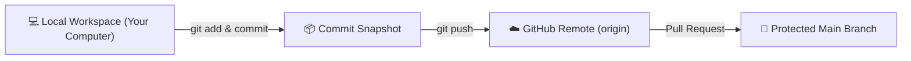
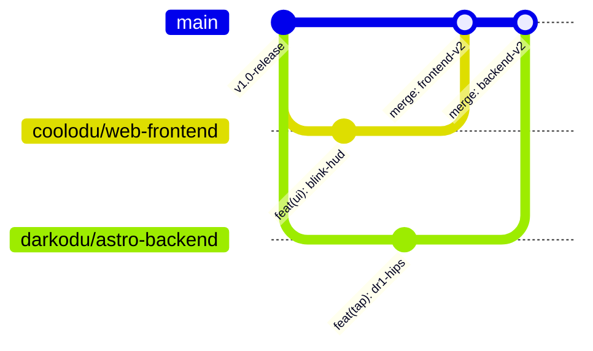

# 🐙 GitHub Master Guide for SPHEREx Hunter
> **NASA Space Apps Challenge 2026** | **Team RIP (Coimbatore, India)**  
> **Challenge:** Planet X and SPHEREx | **Target Audience:** GitHub Newbies & Experienced Developers

---

## 🗺️ Table of Contents
1. [🌟 Section 1: The Absolute Beginner's Guide (GitHub Newbies)](#-section-1-the-absolute-beginners-guide-github-newbies)
   - [What is GitHub in Plain English?](#what-is-github-in-plain-english)
   - [Key Concepts & Visual Cheat Sheet](#key-concepts--visual-cheat-sheet)
   - [How to Explore This Repo in 3 Clicks (Zero Terminal Needed)](#how-to-explore-this-repo-in-3-clicks-zero-terminal-needed)
   - [Running the SPHEREx Hunter App Locally (Beginner Friendly)](#running-the-spherex-hunter-app-locally-beginner-friendly)
   - [How to Report a Bug or Suggest an Idea](#how-to-report-a-bug-or-suggest-an-idea)
2. [⚡ Section 2: Developer & Power User Guide (GitHub Users)](#-section-2-developer--power-user-guide-github-users)
   - [Multi-Branch Architecture & Ownership](#multi-branch-architecture--ownership)
   - [GitHub Flow & Working on Branches](#github-flow--working-on-branches)
   - [Commit Message Conventions](#commit-message-conventions)
   - [Verification & Automated CI Testing](#verification--automated-ci-testing)
   - [Submitting a Pull Request (PR)](#submitting-a-pull-request-pr)
3. [🛡️ Guardrails & Emergency Recovery](#️-guardrails--emergency-recovery)

---

## 🌟 Section 1: The Absolute Beginner's Guide (GitHub Newbies)

### What is GitHub in Plain English?
Imagine Google Drive, but specially designed for software, NASA satellite data, and science projects:
- **Repository (Repo):** A digital project folder stored securely in the cloud containing all code, scientific docs, and images.
- **Commit:** A saved snapshot or checkpoint in time. If you make a mistake, you can always jump back to an earlier checkpoint.
- **Branch:** A parallel workspace. Think of it like making a photocopy of a document to write notes on—the original master document remains 100% safe.
- **Pull Request (PR):** A friendly formal request asking the team lead: *"Hey, I finished this feature on my branch, please review and merge it into the main project!"*
- **Issue:** A digital to-do ticket or bug report where team members discuss tasks.



---

### Key Concepts & Visual Cheat Sheet

| GitHub Term | Real-World Analogy | What It Does in SPHEREx Hunter |
| :--- | :--- | :--- |
| **`main`** | The Master Blueprint | The verified, live version of our application. |
| **`origin`** | The Cloud Master | The GitHub cloud server (`github.com/joker0210G/spherex-hunter-vercel`). |
| **Clone** | Downloading a Project Copy | Downloads the entire project and its full history to your laptop. |
| **Pull (`git pull`)** | Updating / Refreshing | Grabs the latest changes made by your teammates from GitHub. |
| **Push (`git push`)** | Uploading / Publishing | Uploads your saved commits from your laptop to GitHub. |
| **Issue** | Digital Sticky Note / Task | Tracks bugs, features, and teammate assignments. |

---

### How to Explore This Repo in 3 Clicks (Zero Terminal Needed)

You don't even need to open a terminal to explore SPHEREx Hunter!

#### Option A: Use the GitHub Web Interface
1. Visit the repository: [https://github.com/joker0210G/spherex-hunter-vercel](https://github.com/joker0210G/spherex-hunter-vercel)
2. Click on the **Code** tab to browse folders like `frontend/` (the user interface) or `backend/` (FastAPI astronomy server).
3. To search for any file (like `index.html`), simply press <kbd>T</kbd> on your keyboard.

#### Option B: GitHub Web Editor (Secret Superpower!)
1. While on the GitHub repository page, press the <kbd>.</kbd> (period/dot) key on your keyboard.
2. GitHub will instantly launch a full web-based VS Code editor in your browser!
3. You can read code, view markdown docs, and browse without installing anything.

#### Option C: Download as ZIP
1. Click the green **Code** button at the top-right of the repository page.
2. Click **Download ZIP**.
3. Extract the ZIP folder anywhere on your computer.

---

### Running the SPHEREx Hunter App Locally (Beginner Friendly)

Once you have the code on your computer:

1. **Open PowerShell or Terminal** in the project folder (`d:\Workspace\NASA_Space_apps`).
2. **Start the Observatory Server:**
   ```powershell
   python -m uvicorn backend.main:app --host 127.0.0.1 --port 8000 --reload
   ```
3. **Open Your Browser:**
   Go to: [http://127.0.0.1:8000/app/index.html](http://127.0.0.1:8000/app/index.html)
4. **Enjoy Exploring:**
   - Use the **Target Presets** dropdown to blink multi-epoch images for **WISE 0855**, **Barnard's Star**, or **RW Aurigae**.
   - Watch the bottom status bar dynamically track coordinates, zoom, and active survey epochs (`2MASS`, `WISE`, `SPHEREx Stack`).

---

### How to Report a Bug or Suggest an Idea

If you spot an issue or visual glitch:
1. Go to the [Issues Tab](https://github.com/joker0210G/spherex-hunter-vercel/issues).
2. Click the green **New Issue** button.
3. Select the template that fits your discovery:
   - 🐛 **Bug / Visual Glitch Report**
   - 🌐 **Web Frontend Enhancement**
   - 🔭 **Astro Backend & TAP Data**
   - 🧮 **Image Math & AI Analysis**
4. Fill in what you saw, paste a screenshot, and click **Submit new issue**!

---

## ⚡ Section 2: Developer & Power User Guide (GitHub Users)

### Multi-Branch Architecture & Ownership

To prevent merge conflicts during hackathon sprints, Team RIP uses strict branch segmentation:



| Branch Name | Role / Owner | Scope & Working Directory |
| :--- | :--- | :--- |
| **`main`** | `jokerodu` (Lead) | Protected master branch. Production-ready, verified releases. |
| **`coolodu/web-frontend`** | `coolodu` | WebGL canvas, FITS rendering, HUD telemetry, responsive layouts (`frontend/`). |
| **`darkodu/astro-backend`** | `darkodu` | FastAPI endpoints, TAP queries, HiPS context layer, FITS cutouts (`backend/`). |
| **`iceodu/image-math-ai`** | `iceodu` | PSF convolution, ZOGY image subtraction, SNR co-addition (`image_engine/`). |
| **`astrodu/ui-story-pitch`** | `astrodu` | Presentation slide deck, citizen science docs, video script (`docs/`). |

---

### GitHub Flow & Working on Branches

#### 1. Always Start by Syncing Local `main`
```bash
git checkout main
git pull origin main
```

#### 2. Switch to Your Assigned Track Branch
```bash
# Example for frontend work:
git checkout coolodu/web-frontend
git merge main
```

#### 3. Stage and Check Diff Carefully
```bash
# Inspect changed files
git status -sb

# Review line-by-line diffs
git diff
```

#### 4. Atomic Commits with Conventional Commits
```bash
git add frontend/index.html
git commit -m "feat(hud): consolidate viewport resolution and active frame telemetry"
```

#### 5. Push to Remote Branch
```bash
git push origin coolodu/web-frontend
```

---

### Commit Message Conventions

We enforce [Conventional Commits v1.0.0](https://www.conventionalcommits.org/):

* `feat(scope): ...` – New feature (e.g. `feat(viewport): add dynamic epoch badge`).
* `fix(scope): ...` – Bug fix (e.g. `fix(hud): remove orphan pipe in target chip`).
* `refactor(scope): ...` – Code refactoring without behavioral change.
* `docs(scope): ...` – Documentation updates or sync logs.
* `test(scope): ...` – Adding or updating automated test suites.
* `perf(scope): ...` – Performance optimizations (RAF throttling, matrix caching).

---

### Verification & Automated CI Testing

Before opening any Pull Request or asking for a merge into `main`, verify all test contracts locally:

```powershell
# Run the complete test suite
python -m pytest tests/test_ui_contract.py tests/test_golden_suite.py tests/test_viewport_overhaul_v2.py

# Verify code formatting and linting
ruff check backend/
```

> [!IMPORTANT]
> **Zero Ghost Closures Rule:** All 3 verification gates must pass:
> 1. Git commit hash exists on branch.
> 2. DOM elements and backend endpoints physically exist in the files.
> 3. Targeted test suite passes 100% green.

---

### Submitting a Pull Request (PR)

1. Navigate to [Pull Requests](https://github.com/joker0210G/spherex-hunter-vercel/pulls).
2. Click **New Pull Request**.
3. Set **Base:** `main` $\leftarrow$ **Compare:** `your-branch` (e.g. `coolodu/web-frontend`).
4. Title your PR clearly: `feat(hud): Streamline viewport overlays and merge active frame badge`.
5. In the description, link any relevant issue numbers (e.g. `Closes #27`).
6. Request a review from `jokerodu`.

---

## 🛡️ Guardrails & Emergency Recovery

### "Help, I Made a Mistake Locally!"
* **Discard uncommitted changes in a specific file:**
  ```bash
  git restore path/to/file
  ```
* **Check the commit history safety log:**
  ```bash
  git reflog
  ```
* **Never use `git push --force` on `main`!** Shared history is protected.

---

> 🛰️ **Team RIP Motto:** *Automate the math, protect the main branch, discover Planet X!*
