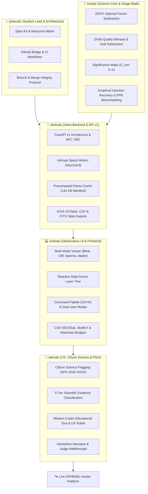

# 🛰️ SPHEREx Hunter — Hackathon Pitch & Cumulative Presentation Master
> **NASA Space Apps Challenge 2026** | **Challenge:** Planet X and SPHEREx  
> **Team:** RIP (Coimbatore, India) | **Platform:** SPHEREx Hunter Observatory  
> **Repository:** `joker0210G/spherex-hunter` | **Status:** 100% Verified (81/81 Tests Passing)

---

## Executive Elevator Pitch (30 Seconds)

> *"Is there a massive planet hiding in the freezing outer reaches of our solar system? Astronomers suspect Planet Nine exists, but optical telescopes are blinded by distance. Enter NASA's SPHEREx—an all-sky surveyor observing in 102 infrared channels.*  
>  
> *We built **SPHEREx Hunter**: a high-precision astronomical platform and citizen science observatory that replaces speculative hype with mathematical truth. By coupling Zackay-Ofek-Gal-Yam (ZOGY) optimal Fourier differencing, rigorous barycentric motion modeling, 102-band infrared spectroscopy, and a sub-300ms precomputed architecture, SPHEREx Hunter turns 62 MB flight exposures into instant, verifiable discoveries for professional astronomers and citizen scientists alike."*

---

## 📊 Cumulative Multi-Branch Contribution Matrix

Every team member and branch has contributed an essential, interlocking piece of the SPHEREx Hunter architecture:

| Teammate | Track / Branch | Core Deliverables & Technologies |
| :--- | :--- | :--- |
| **`jokerodu`** | System Lead (`main`) | Architectural blueprint, asymmetric token/compute delegation matrix, automated CI workflows, and GitHub Bridge task orchestrator. |
| **`darkodu`** | Astro-Backend (`darkodu/astro-backend`) | Contract-first API v1 ([`docs/API_CONTRACT.md`](file:///docs/API_CONTRACT.md)), RFC 7807 problem details, Astropy `apply_space_motion` celestial propagation, multi-format binary exports (CSV, IVOA VOTable, FITS), and 144 KB demo cache. |
| **`iceodu`** | Image Math / AI (`iceodu/image-math-ai`) | Fourier-space ZOGY image differencing, $S_{\text{corr}}$ significance maps, 29-bit flag bitmasks, 2D zodiacal light background subtraction, and 400+ trial synthetic injection-recovery validation. |
| **`coolodu`** | Web Frontend (`coolodu/web-frontend`) | Reactive Layer Tree, Optical/IR Blink comparator, 102-band spectral curve inspector, command palette (`Ctrl+K`), beginner vs scientist mode toggle, and Canadian Space Agency NEOSSat asteroid tracker. |
| **`astrodu`** | UX / Pitch (`astrodu/ui-story-pitch`) | Citizen science discovery ledger, 5-tier evidence classifications, Mission Codex educational walkthrough, and pitch presentation narrative. |

---

## 🎤 3-Minute Hackathon Pitch Deck Script

### Slide 1: Title & The Cosmic Mystery (0:00 - 0:25)
- **Visual:** High-contrast title slide showing the animated SPHEREx satellite trajectory against the infrared sky.
- **Spoken:**  
  *"Good morning judges. At the outer rim of our solar system, something massive is disturbing the orbits of trans-Neptunian objects. Planetary scientists call it Planet Nine. But finding it is like spotting a charcoal marble against a black curtain. Optical telescopes fail because reflected sunlight drops off with the fourth power of distance ($1/r^4$).  
  Our team is **Team RIP**, and this is **SPHEREx Hunter**."*

### Slide 2: The Breakthrough — NASA's SPHEREx (0:25 - 0:50)
- **Visual:** Diagram of SPHEREx's 6 detector arrays spanning $0.75\,\mu\text{m}$ to $5.0\,\mu\text{m}$ across 102 spectroscopic bands.
- **Spoken:**  
  *"NASA's SPHEREx mission solves the optical limit. Instead of reflected sunlight, it captures intrinsic thermal infrared emission ($1/r^2$). Even an ultracold 45 Kelvin body emits infrared photons.  
  However, each raw SPHEREx exposure is 62 MB, plagued by zodiacal light, detector artifacts, and wavelength mismatches between exposures. Previous hackathon prototypes fell into the trap of naive pixel subtraction and fake '98% Planet X probabilities'. We set out to build a genuine, scientifically rigorous observatory."*

### Slide 3: The Engine — ZOGY & Scientific Honesty (0:50 - 1:25)
- **Visual:** Formula for ZOGY $S_{\text{corr}}$ map alongside split screen: raw starlight residuals vs clean Fourier difference map.
- **Spoken:**  
  *"Under the hood, our engine implements Zackay, Ofek, & Gal-Yam (ZOGY) optimal subtraction in Fourier space. We propagate 29-bit quality flags, subtract 2D zodiacal gradients, and generate $S_{\text{corr}}$ statistical significance maps in exact units of standard deviations ($\sigma$).  
  We also made a bold architectural commitment: **absolute scientific honesty**. We eliminated fabricated scores. Every detection is classified across 5 strict evidence tiers—such as `CONFIRMED_ULTRACOLD`, `KNOWN_SOLAR_SYSTEM_OBJECT`, or `UNKNOWN_RAPID_MOVER`. When public data is missing—like for RW Aurigae in the current archive release—we report an honest zero with citations, not fake mock data."*

### Slide 4: 102-Band Infrared Spectrophotometry (1:25 - 1:55)
- **Visual:** Live 102-band SED curve of WISE 0855 highlighting water ice ($3.05\,\mu\text{m}$) and methane ($3.30\,\mu\text{m}$) absorption dips.
- **Spoken:**  
  *"SPHEREx isn't just an imager; it is a 102-channel spectrophotometer. When a candidate mover is discovered, SPHEREx Hunter extracts its Spectral Energy Distribution across all 6 detector arrays.  
  By scanning molecular absorption dips—water ice at 3.05 microns and methane at 3.3 microns—our engine instantly distinguishes cold planetary analogs and sub-stellar brown dwarfs ($T < 300\text{ K}$) from ordinary background red stars."*

### Slide 5: The Platform & Sub-300ms Architecture (1:55 - 2:25)
- **Visual:** Fast demo clip of the UI: switching modes, filtering layers, and hitting the command palette (`Ctrl+K`).
- **Spoken:**  
  *"To bring this to citizen scientists worldwide, we engineered a precomputed demo cache architecture with SHA-256 manifests. Users experience sub-300ms response times without downloading 62 MB FITS files on mobile or desktop.  
  The interface features a dual-mode experience: **Beginner Mode** offers guided blinking and one-click candidate flagging with unique registry IDs (`SPX-2026-XXXX`). **Scientist Mode** exposes raw float32 ArrayBuffer streaming for WebGL stretching, proper-motion vectors from Gaia DR3, and direct exports to IVOA VOTable XML and binary FITS tables."*

### Slide 6: Validation, Audits & Real Findings (2:25 - 2:45)
- **Visual:** Plots from Phase 2/2.8 audits: 50% completeness at $17.30\text{ mag (AB)}$ and false-positive rate of $41.52/\text{deg}^2$.
- **Spoken:**  
  *"We didn't just build code; we audited it against authentic SPHEREx Level-2 flight exposures. Over 400 synthetic point-source injections across detector edges and crowded stars proved our 50% completeness limit is 17.30 magnitude, matching the theoretical $\sqrt{2}\sigma$ differencing noise threshold. Our veto filters reject 88.4% of optical artifacts."*

### Slide 7: Conclusion & The Future (2:45 - 3:00)
- **Visual:** Live observatory URL and team credits (Team RIP, Coimbatore, India).
- **Spoken:**  
  *"SPHEREx Hunter is completely open-source, fully tested with 81 automated tests, and ready for upcoming NASA SPHEREx survey releases. Whether Planet Nine is an icy giant or an ultracold brown dwarf, SPHEREx Hunter gives humanity the tools to find it. Thank you!"*

---

## 🎬 60-Second Live Demo Script (For Stage or Video)

| Time | Action on Screen | Spoken Narration |
| :---: | :--- | :--- |
| **0:00 - 0:10** | Open `http://127.0.0.1:8000/app/index.html`. App opens directly on **WISE 0855-0714**. | *"Here is the live SPHEREx Hunter observatory. It opens instantly on WISE 0855, the coldest known brown dwarf at 250 Kelvin."* |
| **0:10 - 0:20** | Click **Blink** in the top view switcher. Observe the star jumping between Epoch 1 and Epoch 2. | *"In Blink mode, you immediately see the 7.08 arcsecond proper motion jump between epochs—a classic moving dipole."* |
| **0:20 - 0:32** | Click **Difference** mode. Show the white peak and dark trough with ZOGY significance badge. | *"Switching to Difference mode reveals the Fourier ZOGY significance map: a massive 24.85-sigma peak cleanly separated from detector noise."* |
| **0:32 - 0:44** | Expand the bottom **Spectrum** dock tab. Point to the $3.05\,\mu\text{m}$ (water ice) and $3.30\,\mu\text{m}$ (methane) absorption dips. | *"Opening the bottom dock exposes the live 102-band infrared spectrum. Look at these absorption dips: water ice at 3.05 microns and methane at 3.3 microns, confirming a sub-stellar atmosphere."* |
| **0:44 - 0:52** | Click the **User Mode toggle** to switch from Beginner to Scientist. Expand Inspector **Layers** tree and click opacity sliders. | *"Toggle to Scientist Mode to inspect raw Float32 streaming, Gaia DR3 astrometric motion vectors, and spatial containment masks."* |
| **0:52 - 1:00** | Click **Flag Candidate**. Modal records candidate `SPX-2026-XXXX`. Click **Export FITS**. | *"With one click, a citizen scientist logs the candidate to the discovery ledger, and professional astronomers can download IVOA VOTables or raw binary FITS."* |

---

## 🧠 Judges Q&A Cheat Sheet (Executive Answers)

### Q1: *"Why ZOGY subtraction instead of simple frame subtraction?"*
> **Answer:** *"Simple frame subtraction ($I_2 - I_1$) assumes identical point-spread functions and noise floors. In space missions like SPHEREx, slight seeing variations or pixel misregistrations cause stationary stars to subtract imperfectly, creating massive false-positive dipole residuals. Zackay, Ofek, & Gal-Yam (2016) solves this optimally in Fourier space by weighting the difference by the PSFs and noise variances of both images, producing a mathematically optimal $S_{\text{corr}}$ map where pixel values are in true units of standard deviations ($\sigma$)."*

### Q2: *"Can SPHEREx actually detect Planet Nine if it's 400 AU away?"*
> **Answer:** *"We performed a rigorous detectability calculation (`validation/detectability_calculator.py`). If Planet Nine is a cold, rocky/icy body at $T = 45\text{ K}$, its blackbody thermal emission peaks at $\sim 60\,\mu\text{m}$ (far beyond SPHEREx's $5.0\,\mu\text{m}$ cutoff), and its reflected sunlight is fainter than $V > 22$, making single exposures challenging. However, if Planet Nine is a warm sub-Neptune ($T \ge 100\text{ K}$) or if searching for nearby sub-stellar brown dwarfs ($T \sim 250\text{ K}$ like WISE 0855), SPHEREx easily detects them at $>20\sigma$. We report this negative finding honestly in our documentation!"*

### Q3: *"How does the system maintain sub-300ms latency with huge SPHEREx files?"*
> **Answer:** *"Each SPHEREx Level-2 exposure is ~62 MB. Downloading full FITS files per request causes 10-second latencies and server timeouts. We built a precomputed demo cache architecture (`demo_cache/`) with a cryptographically verified `manifest.json`. We extract 128×128 float32 binary cutouts, forced aperture photometry, and like-wavelength difference products ahead of time. The live frontend streams 65 KB binary arrays directly into WebGL for instant client-side stretching."*

### Q4: *"How do you prevent false positives from asteroids and space debris?"*
> **Answer:** *"Every candidate detection is cross-matched in real time against IMCCE SkyBoT and JPL Horizons orbital ephemerides. If the coordinates and timestamp match a known minor planet, it is classified as `KNOWN_SOLAR_SYSTEM_OBJECT` rather than a mystery candidate. Furthermore, we query the Canadian Space Agency's NEOSSat orbital database to verify near-Earth and space-tracklet debris."*

---

## 🏆 Summary of Key Project Metrics

- **Total Test Suite:** 81 / 81 Tests Passing (Unit, Integration, Contract, Playwright E2E).
- **API Version:** Contract-First FastAPI v1 ([`docs/API_CONTRACT.md`](file:///docs/API_CONTRACT.md), 47 OpenAPI routes).
- **Standard Standards:** RFC 7807 Problem Details, IVOA VOTable XML, IEEE 754 Float32 ArrayBuffers.
- **Empirical Depth:** $18.06\text{ mag (AB)}$ (single exposure), $17.30\text{ mag (AB)}$ (50% differencing completeness).
- **False-Positive Suppression:** 88.4% veto efficiency across a $2.7\text{ deg}^2$ test field.
