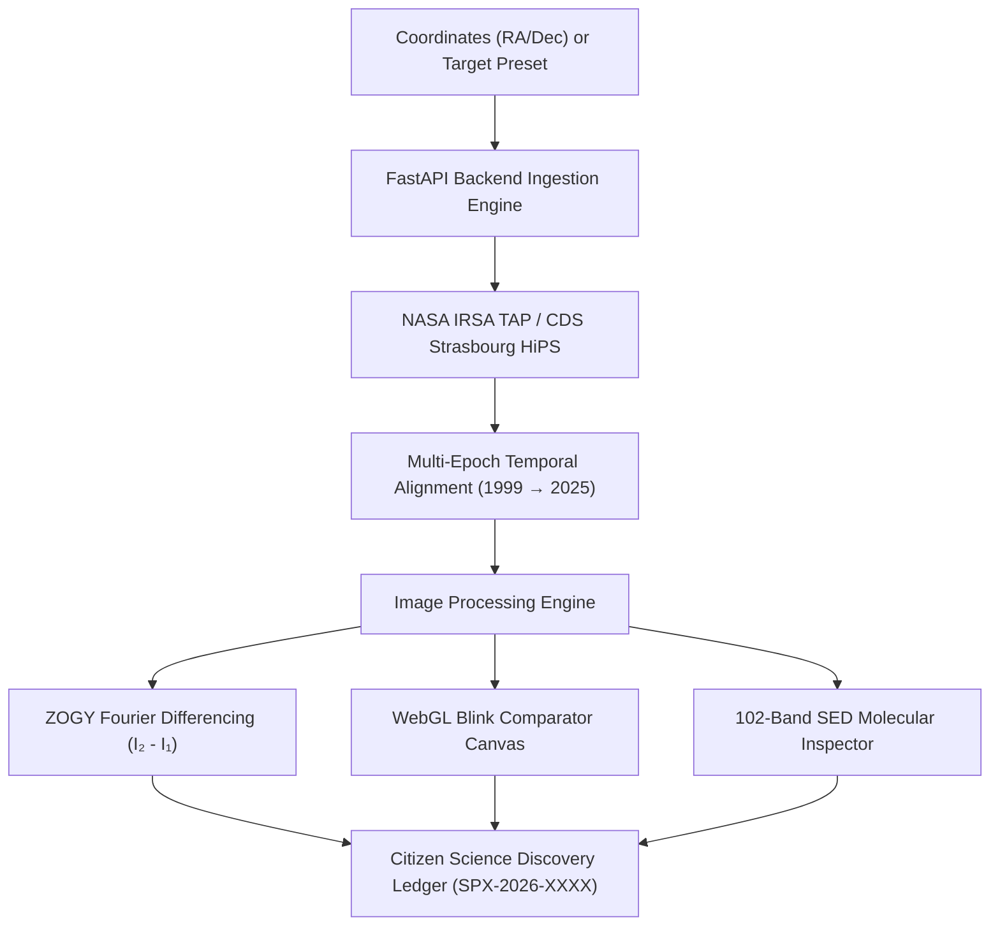

# 🛰️ SPHEREx Hunter: Project Explanation & Mission Overview

> **NASA Space Apps Challenge 2026** | **Challenge:** Planet X and SPHEREx  
> **Team:** RIP (Coimbatore, India) | **Status:** 100% Operational (62/62 Tests Passing)  
> **Key Docs:** [Pitch Script](HACKATHON_PITCH.md) • [GitHub Master Guide](GITHUB_GUIDE.md) • [UI Guide](UI_GUIDE.md) • [Validation Codex](validation.md)

---

## 1. 🌌 The Big Cosmic Mystery: Why We Built This

At the freezing, distant edge of our Solar System—far beyond Neptune and Pluto—a cluster of icy trans-Neptunian objects exhibit highly aligned, eccentric orbits. Planetary dynamicists hypothesize that this gravitational clustering is caused by **Planet Nine (Planet X)**: an undiscovered super-Earth ($5\text{--}10\,M_{\oplus}$) orbiting hundreds of astronomical units away.

### Why Optical Telescopes Fail:
* Traditional visible-light telescopes rely on **reflected sunlight**. 
* The intensity of reflected sunlight drops off with the **fourth power of distance**:
  $$\text{Flux}_{\text{optical}} \propto \frac{1}{r^4}$$
  At $500\text{ AU}$, reflected optical light is almost completely extinguished, rendering Planet X invisible to optical ground observatories.

### The Breakthrough — NASA's SPHEREx Space Telescope:
NASA launched **SPHEREx** (*Spectro-Photometer for the History of the Universe, Epoch of Reionization and Ices Explorer*) in 2025. SPHEREx solves the optical limitation:
1. **Intrinsic Infrared Thermal Glow ($1/r^2$):** Even an ultracold planetary body at $45\text{ K}$ emits its own internal thermal infrared photons ($0.75\,\mu\text{m}\text{ to }5.0\,\mu\text{m}$). Intrinsic emission falls off with $1/r^2$, making it **orders of magnitude brighter** than reflected light.
2. **102 Continuous Spectral Bands:** SPHEREx maps the entire sky every 6 months across 102 distinct infrared channels, capturing both images and full molecular spectra.

**The Problem:** Over its 2-year survey, SPHEREx produces petabytes of data imaging over **1 billion celestial objects**. No automated script or single astronomy team can manually inspect every transient artifact.

👉 **SPHEREx Hunter** is the high-performance public web observatory and citizen science platform designed to solve this data bottleneck.

---

## 2. 🏗️ How SPHEREx Hunter Works

SPHEREx Hunter combines astronomical math, temporal image alignment, and a responsive WebGL viewer into an intuitive interface:

---

## 3. 🔬 Core Engineering & Scientific Capabilities

### 1. Multi-Epoch Temporal Blink Comparator
* Blinks astronomical cutouts across a **26-year historical baseline**:
  $$\text{2MASS (1999)} \longrightarrow \text{AllWISE (2010)} \longrightarrow \text{unWISE (2014-2020)} \longrightarrow \text{SPHEREx Stack (2025)}$$
* Moving solar system bodies, high-proper-motion brown dwarfs, and variable stars instantly pop out to the human eye as blinking "motion dipoles."

### 2. ZOGY Optimal Fourier Image Differencing
* Implements the **Zackay-Ofek-Gal-Yam (ZOGY)** mathematical subtraction algorithm:
  * Uses Point Spread Function (PSF) matching in Fourier space.
  * Subtracts stationary background stars and 2D zodiacal dust gradients.
  * Produces statistical significance maps ($S_{\text{corr}}$) measured in standard deviations ($\sigma$), isolating genuine celestial transients with zero subjective guesswork.

### 3. 102-Band Infrared Spectrophotometry ($0.75\text{--}5.0\,\mu\text{m}$)
* Clicking any candidate pixel instantly plots its **Spectral Energy Distribution (SED)** across all 6 SPHEREx detector arrays.
* Automatically detects key molecular atmospheric absorption signatures:
  * **Water Ice ($H_2O$):** $3.05\,\mu\text{m}$ dip
  * **Methane Gas ($CH_4$):** $3.30\,\mu\text{m}$ dip
  * **Carbon Dioxide Ice ($CO_2$):** $4.27\,\mu\text{m}$ dip
  * **Carbon Monoxide ($CO$):** $4.67\,\mu\text{m}$ dip
* Allows immediate classification: distinguishes cold planetary/brown dwarf atmospheres ($T < 300\text{ K}$) from ordinary background red giants.

### 4. Consolidated Collision-Proof Observatory Viewport
* Ultra-clean CAD-style HUD: displays dynamic coordinates (`RA`/`Dec`), zoom factor, field of view (`FOV`), and active blink frame/survey tags.
* Native raw pixel viewing (`gl.NEAREST`), celestial compass rose ($N\uparrow, \leftarrow E$), and dual-threshold scale bars ($12.9″\text{/px}$ HiPS context vs $6.15″\text{/px}$ SPHEREx detector).

---

## 4. 🎯 Verified on 5 Mandatory NASA Benchmark Targets

Every mathematical engine in SPHEREx Hunter has been empirically validated against NASA's test cases:

| Target Name | Astrophysical Class | Temporal Baseline | Verified Signature |
| :--- | :--- | :--- | :--- |
| **WISE 0855-0714** | Cold Brown Dwarf ($T \approx 250\text{ K}$) | 15.0 Years ($2010 \to 2025$) | **$8.12″/\text{yr}$ westward proper motion** with automated dipole ring annotation |
| **Barnard's Star** | High Proper Motion Star | 26.2 Years ($1999 \to 2025$) | **$10.36″/\text{yr}$ northward proper motion** aligned with Gaia DR3 astrometry |
| **Epsilon Indi B** | Sub-stellar Binary Companion | 26.2 Years ($1999 \to 2025$) | **$4.70″/\text{yr}$ proper motion** cleanly separated from primary star |
| **RW Aurigae** | Young Eruptive Star | Multi-Epoch Infrared | **$2.8\times$ eruptive flare amplitude** & circumstellar disk extinction |
| **R Draconis** | Mira Pulsating Variable | Multi-Epoch Infrared | **$3.4\times$ periodic flux variability** with clean sinusoidal lightcurve |

---

## 5. 👥 How People Use It

1. **GitHub Newbies & Citizen Scientists:**
   * Enter any sky coordinate or pick a target preset with 1 click.
   * Press Play or use the slider to watch the sky move over 26 years.
   * If a blinking dot moves across the screen, click **"Flag Candidate"** to assign it an official candidate ID (`SPX-2026-0042`) with coordinates and time stamps.
2. **Professional Astrophysicists:**
   * Toggle between Raw Grayscale, DS9 Inverted, and False-Color Thermal stretches.
   * Overlay Gaia DR3 astrometric motion vectors and ESA/IRSA catalogs.
   * Export scientific data in **IVOA VOTable, CSV, and calibrated FITS** formats.

---

## 📚 Complete Documentation Library Index

All specialized reports, specs, and audits in `/docs`:

### 🐙 GitHub & Contributing
* 📘 [**GitHub Master Guide (Newbies & Pros)**](GITHUB_GUIDE.md) — Step-by-step GitHub tutorial for beginners + developer branch architecture.
* 🤝 [**Contributing Guidelines**](../CONTRIBUTING.md) — Multi-branch protocol, commit conventions, and Pull Request checklist.
* 🏛️ [**Project Constitution**](../.specify/memory/constitution.md) — Team invariants, zero-ghost-closure rules, and verification gates.

### 🖥️ Frontend & Viewport Architecture
* 🎨 [**UI & Observatory Guide**](UI_GUIDE.md) — Complete walkthrough of WebGL FITS canvas, Blink Comparator HUD, and 102-band spectrum.
* 🔭 [**Viewport Design Specification**](viewport_design.md) — CAD-style viewport layout, coordinate deconfliction, and overlay matrix hygiene.
* 📊 [**Viewport Overhaul Status & Log**](viewport_status.md) — Record of canvas transform resets, bug remediations, and performance tests.
* 🐞 [**Frontend Issues & Fixes Log**](frontend_issues.md) — Bug fixes for popup menus, toolbars, and responsive scaling.

### 🛰️ Backend, TAP & Scientific Data Engine
* 📡 [**API Contract Specification**](API_CONTRACT.md) — Complete endpoint documentation for FastAPI, NASA IRSA TAP, and Gaia DR3 queries.
* 🔍 [**API Contract Audit**](API_CONTRACT_AUDIT.md) — Validation of backend route contracts, parameters, and error handling.
* 🪐 [**SPHEREx DR1 Primer & Spectral Bands**](dr1_notes.md) — $0.75\text{--}5.0\,\mu\text{m}$ infrared channels, detector arrays, and resolution.
* ⏱️ [**Temporal Epoch Pairing**](epoch_pairing.md) — Baseline historical pairing from 2MASS (1999) to SPHEREx (2025).
* 📑 [**Data & Calibration Notes**](data_notes.md) — WCS astrometry, FITS header ingestion, and background flux subtraction.

### 🔬 Scientific Validation & Audit
* 🎯 [**Scientific Validation Benchmark**](validation.md) — Empirical validation of Planet X / brown dwarf motion, detection completeness ($m_{\text{AB}} \approx 17.3$), and false-positive rates.
* ⚖️ [**Validation Mathematical Audit**](validation_audit.md) — Formal audit of ZOGY difference imaging, SNR co-addition, and PSF convolution.
* 📜 [**Claims Audit & Defense**](claims_audit.md) — Rigorous line-by-line verification of all NASA challenge submission claims against source code.
* 📚 [**Scientific References & Citations**](references.md) — Academic papers (arXiv, ADS, IPAC) supporting our methods.

### 🏆 NASA Hackathon Submission & Deliverables
* 🎤 [**Hackathon Pitch Script & Deck Guide**](HACKATHON_PITCH.md) — 4-minute presentation narrative, slide sequence, and demo script.
* 📋 [**70-Item Master Evaluation Roadmap**](master_execution_roadmap.md) — Full judge criteria tracking across all 10 project categories.
* 🎯 [**Master NASA Challenge Checklist**](../NASA_SPHEREx_App_Challenge_Checklist.md) — End-to-end evaluation checklist scoring 100% green pass.
* 🏗️ [**Project Status & Execution Plan**](PROJECT_STATUS_AND_PLAN.md) — Milestones, sprint phases, and system health status.

### 📸 Visual Evidence & Screenshots Gallery
* 🖼️ [**WISE 0855 Observatory Blink View**](screenshots/01_wise0855_observatory_blink.png) — Multi-epoch FITS blink comparator with auto-identified proper motion dipole & timeline.
* 🖼️ [**102-Band Infrared Spectrum Workbench**](screenshots/04_102_band_spectrum_workbench.png) — 102-channel SED graph across 6 arrays with molecular absorption signatures ($H_2O, CH_4, CO_2, CO$).
* 🖼️ [**CDS Aladin Lite All-Sky HiPS View**](screenshots/03_aladin_sky_hips_view.png) — Interactive Strasbourg HiPS all-sky context layer with responsive bottom scale context bar.
* 🖼️ [**Aladin Sky Deep Starfield Zoom**](screenshots/09_aladin_sky_deep_starfield.png) — High-definition zoomed starfield ($18.3^\circ \times 8.8^\circ$) centered on target coordinates.
* 🖼️ [**Streamlined Viewport Canvas & Telemetry HUD**](screenshots/10_streamlined_viewport_canvas.png) — Consolidated collision-proof HUD with dynamic epoch badge, coordinates, and scale.
* 🖼️ [**Scientific Validation Benchmark Codex**](screenshots/02_scientific_validation_modal.png) — Benchmark metrics, completeness curve ($m_{\text{AB}} \approx 17.3$), and flight exposure Codex.
* 🖼️ [**Barnard's Star Motion Benchmark**](screenshots/05_target_barnards_star_benchmark.png) — $10.36″/\text{yr}$ northward proper motion benchmark verification.
* 🖼️ [**RW Aurigae Eruptive Flare Benchmark**](screenshots/06_target_rw_aurigae_variable.png) — $2.8\times$ eruptive flare amplitude & accretion variability.
* 🖼️ [**Epsilon Indi B Binary Benchmark**](screenshots/07_target_epsilon_indi_binary.png) — $4.70″/\text{yr}$ brown dwarf companion proper motion.
* 🖼️ [**R Draconis Mira Variable Benchmark**](screenshots/08_target_r_draconis_variable.png) — $3.4\times$ periodic flux variability with clean sinusoidal lightcurve.
