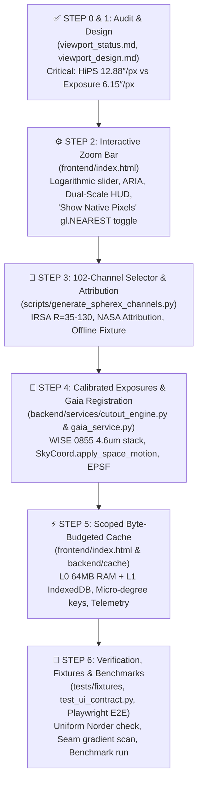

# 🗺️ Master Execution Roadmap: SPHEREx Hunter Viewport Overhaul (Steps 2–6)

> **Document:** `docs/master_execution_roadmap.md`  
> **Team:** RIP (NASA Space Apps Challenge 2026)  
> **Target Files:** `frontend/index.html`, `backend/main.py`, `backend/services/`, `scripts/`, `tests/`  
> **Status:** Step 0 & Step 1 Complete $\to$ Ready for Sequential Implementation (Steps 2–6)

---

## 🧭 End-to-End Execution Sequence

---

## 📋 Detailed Breakdown per Remaining Step

### 🔹 STEP 2: Interactive Logarithmic Zoom Bar (`frontend/index.html`)
1. **DOM Construction & Placement:**
   - Mount floating vertical control dock on the right edge of `#viewportContainer` (`absolute right-4 top-1/2 -translate-y-1/2 z-20`).
   - `#btnVpZoomIn` (`+`), `#vpZoomSlider` (continuous logarithmic track from $0.1^\circ$ to $180^\circ$), `#btnVpZoomOut` (`−`), `#btnVpZoomReset` (`⟲` default $15'$ science scale).
   - `#btnToggleNativePixels`: Nearest-neighbor raw pixel toggle (`🔬 1:1 Pixels`) setting `gl.NEAREST` / `image-rendering: pixelated`.
2. **Accessibility & Keyboard Navigation:**
   - ARIA: `role="slider"`, `aria-valuemin="0.1"`, `aria-valuemax="180"`, `aria-valuenow`, `aria-valuetext="FOV 15.0 arcmin (146 native pixels across view)"`.
   - Keys: `ArrowUp`/`ArrowDown` ($\pm 5\%$), `PageUp`/`PageDown` ($\pm 25\%$), `Home` ($180^\circ$), `End` ($0.1^\circ$).
3. **Bi-Directional Synchronization & Cursor-Centered Zoom:**
   - Slider thumb dynamically updates during mouse wheel (`wheel`), pinch-to-zoom, and WASD keys toward cursor coordinates without circular event feedback.
4. **Dual-Threshold Tooltip & HUD Readouts:**
   - Live telemetry: **Zoom Factor**, **FOV**, **Screen Scale (`arcsec/device_px`)**, **Native Pixel Span (`N px across view`)**, **HiPS Order ($k/k_{\text{max}}$)**.
   - Dual threshold indicators:
     - 🟣 **HiPS Native Scale:** Active at $\theta_{\text{screen}} \le 12.88''/\text{device\_px}$.
     - 🔵 **Exposure Native Scale:** Active at $\theta_{\text{screen}} \le 6.15''/\text{device\_px}$ (with badge: *"Exposure Magnified — Native detector pitch is 6.15″/px"*).

---

### 🔹 STEP 3: Sky Context Layer, 102-Channel Selector & NASA Attribution
1. **Deterministic Channel Generator Script:**
   - Implement `scripts/generate_spherex_channels.py` pulling official IRSA parameters to output `frontend/src/data/spherex_102_channels.json`.
   - 102 channels across Bands 1–6 ($0.753\,\mu\text{m}\text{--}4.988\,\mu\text{m}$, Band 1–3 $R \approx 41$, Band 4 $R = 35$, Band 5 $R = 112$, Band 6 $R = 128$).
   - Static molecular absorption line labels ($\text{H}_2\text{O}$, $\text{CO}_2$, $\text{CO}$, PAH) mapped by wavelength with literature citations.
2. **Aladin Lite 102-Channel Binding:**
   - Wire channel selector `#hipsChannelSelect` to Aladin Lite slice updates with wavelength stepper buttons (`◀` / `▶`).
3. **Persistent Attribution & Provenance Warning:**
   - Persistent HUD attribution: `Credit: NASA / JPL-Caltech / IPAC (SPHEREx DR1)`.
   - Provenance warning: `"DR1 All-Sky Mosaic: Co-added context only (blurs moving objects) — not used for transient/mover detection"`.
4. **Offline Resilience:**
   - Automatic fallback to recorded local HiPS fixture (`tests/fixtures/hips_spherex_dr1_sample/`) if IRSA is unreachable.

---

### 🔹 STEP 4: Calibrated Exposure Layer & Astropy/EPSF Gaia Registration
1. **Calibrated Exposure Overlays & Science FOV ($10'\text{--}30'$):**
   - At $\text{FOV} \le 30'$, mount Level 2 calibrated exposures from `/api/v1/exposures` into Aladin Lite / WCS-slaved canvas with adjustable opacity ($0\text{--}100\%$).
   - Display WCS footprint outlines (`s_region` polygons) and handle `"No Exposure Coverage"` gracefully.
2. **WISE 0855 Multi-Exposure Narrowband Stack near $4.6\,\mu\text{m}$:**
   - For WISE 0855, serve a calibrated stack of 26 exposures centered around $4.6\,\mu\text{m}$ (matching WISE W2).
   - HUD reports: $\text{S/N} = 5.82\sigma$, $N_{\text{exp}} = 26$, Observation Date Range: `2025-05-12 to 2025-05-18 (MJD 60807–60813)`.
3. **Blink vs. Difference Pairing Rules:**
   - Cross-instrument comparisons (2MASS/unWISE vs. SPHEREx) enforce **Blink Mode only** with survey/band badges.
   - **ZOGY Difference Mode ($\Delta$)** is enabled only when backend confirms matched instrument/bandpass pair.
4. **Rigorous Gaia DR3 EPSF Astrometry:**
   - Backend `backend/services/gaia_service.py` runs `astropy.coordinates.SkyCoord.apply_space_motion` from J2016.0 to exposure epoch $J = 2000.0 + (\text{MJD} - 51544.5) / 365.25$.
   - Measures star centroids in cutout using Effective PSF (EPSF) centroiding.
   - Returns and renders astrometric residuals: Median Offset and RMS residual in arcseconds and native pixels.

---

### 🔹 STEP 5: Scoped Byte-Budgeted Cache Engine
1. **Strict Scope Separation:**
   - Aladin Lite + browser HTTP cache manage HiPS tiles.
   - Custom **L0 (64 MB RAM LRU)** and **L1 (IndexedDB `spherex_cutouts_store`)** strictly cache calibrated cutouts and ZOGY difference products.
2. **Quantized Deterministic Cache Keys:**
   - Quantize coordinates to micro-degrees:
     $$\text{ra}_{\mu\text{deg}} = \text{round}(\text{ra} \times 10^5), \quad \text{dec}_{\mu\text{deg}} = \text{round}(\text{dec} \times 10^5)$$
     `Key: {release}:{pipeline_ver}:{product_type}:{exp_id}:ch{channel}:fov{fov_arcsec}:ra{ra_micro}_dec{dec_micro}`
3. **Cross-Browser Idle Prefetching:**
   - Fallback `scheduleIdle` for Safari and Firefox.
   - Safe `navigator.connection?.saveData` inspection.
4. **Telemetry Counters:**
   - Expose metrics separating `l0Hits`, `l1Hits`, `httpCacheHits`, `http304Count`, and `uncachedNetworkFetches`.

---

### 🔹 STEP 6: Testable Verification Suite & Non-Blocking Benchmarks
1. **Deterministic Offline Fixtures:**
   - Build `tests/fixtures/hips_spherex_dr1_sample/` with `properties`, `Moc.fits`, and sample tiles for Orders 0–3.
   - Mock `/api/v1/exposures` for CI offline execution; separate live smoke test (`pytest -m live_irsa`).
2. **Automated Playwright E2E Tests:**
   - Zoom Bar keyboard navigation and ARIA attributes.
   - Network URL inspection verifying single uniform `Norder` at max zoom-out.
   - Automated canvas gradient scan asserting zero wireframe borders or seam discontinuities.
   - WISE 0855 narrowband stack metadata assertion ($\text{S/N}, N_{\text{exp}}$, dates).
   - Cache hit assertion: repeat zoom/blink cycle verifies `uncachedNetworkFetches === 0`.
   - Gaia space motion propagation and EPSF centroid residual verification.
3. **Performance Telemetry:**
   - Measure and report first-tile render ($\le 1.5\text{s}$), p95 cached zoom latency ($< 100\text{ms}$), and zoom FPS ($\ge 55$).
