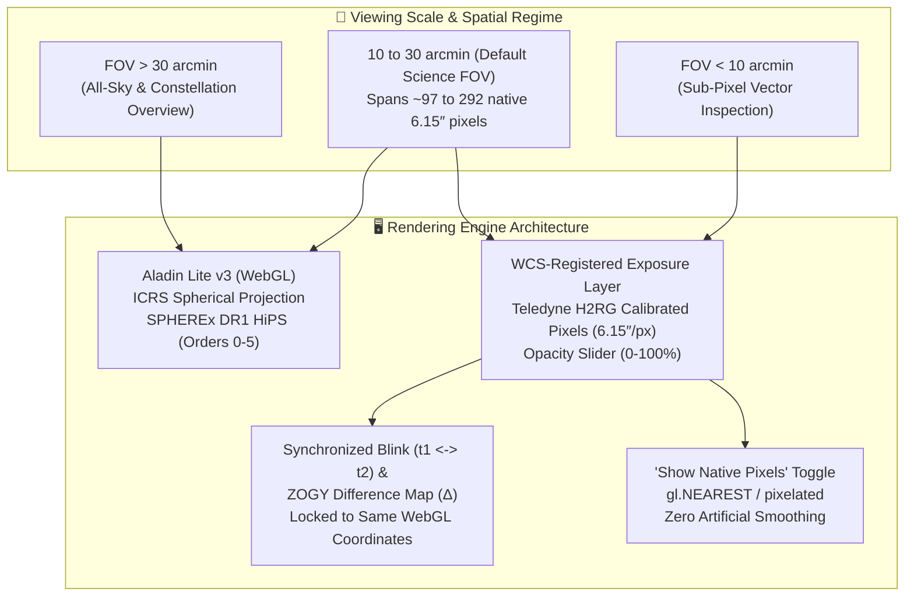
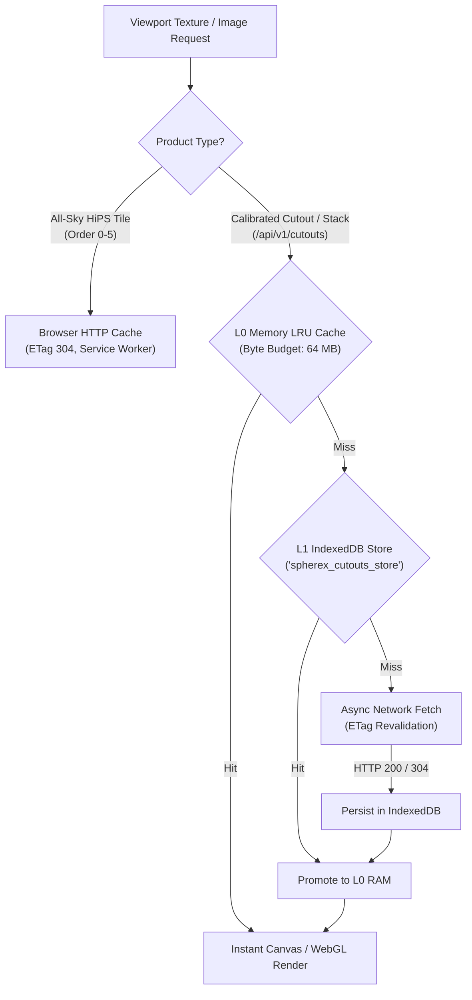

# 📐 Architectural Design Specification: SPHEREx Hunter Viewport Overhaul & Tile Remediation (Step 1)

> **Document:** `docs/viewport_design.md`  
> **Status:** **PROPOSED ARCHITECTURE — PENDING USER APPROVAL (STEP 1 CHECKPOINT)**  
> **Authors:** Lead Astronomical Software Architect & Team RIP (`darkodu`, `coolodu`)  
> **Target Release:** NASA SPHEREx DR1 / QR3 (Pipeline v2.1.0)

---

## 🚨 CRITICAL FEASIBILITY AUDIT HIGHLIGHT (Amendment A7 Checkpoint)

> [!IMPORTANT]
> **FEASIBILITY AUDIT VERDICT: 2 CRITICAL SCIENTIFIC FINDINGS**
>
> 1. **CORS Browser Accessibility: PASSED (Permissive)**
>    Direct browser probing of the official NASA IRSA SPHEREx DR1 HiPS service (`https://irsa.ipac.caltech.edu/data/hips/SPHEREx/spherex_allsky_cube/`) confirmed permissive cross-origin access:
>    - `properties`: `HTTP 200 OK`, `Access-Control-Allow-Origin: *`
>    - `Moc.fits`: `HTTP 200 OK`, `Access-Control-Allow-Origin: *`
>    - `Norder0..5/Dir0/Npix0.png`: `HTTP 200 OK`, `Access-Control-Allow-Origin: *`, `Content-Type: image/png`
>    - WebGL direct texture fetching in Aladin Lite v3 is **fully supported without cross-origin blocking**.
>
> 2. **HiPS Native Scale vs. Detector Scale: COARSER THAN DETECTOR PITCH**
>    Inspection of `properties` reveals:
>    - `hips_order = 5` ($k_{\text{max}} = 5$)
>    - `hips_tile_width = 512` ($W_{\text{tile}} = 512\text{ px}$)
>    - Calculating the Order 5 angular pixel scale:
>      $$\theta_{\text{HiPS}}(k=5) = \frac{\sqrt{4\pi / (12 \times 4^5)}}{512} \times \frac{180 \times 3600}{\pi} \approx \mathbf{12.88''/\text{px}}$$
>    - **The HiPS cube's maximum resolution ($\sim 12.88''/\text{px}$) is STRICTLY COARSER than SPHEREx's native Teledyne H2RG detector pixel pitch of $\mathbf{6.15''/\text{px}}$!**
>    - **Architectural Consequence:** The viewport **must maintain two distinct resolution thresholds**:
>      - **HiPS Native Threshold:** $\sim 12.88''/\text{device\_px}$ (beyond which the all-sky HiPS mosaic is digitally upsampled).
>      - **Exposure Native Threshold:** $\mathbf{6.15''/\text{device\_px}$** (which is ONLY reached when displaying calibrated level 2 exposure cutouts).

---

## 🛠️ ARCHITECTURAL SOLUTIONS FOR THE 5 PRIORITY 0 REGRESSIONS

### 1. Photometric Normalization & Global Stretch Locking
To eliminate the checkerboarding effect where adjacent cutouts exhibit jarring gray level and contrast jumps:
- **Global Field Calibration:** For a given target field and spectral channel, extract global background statistics across the field:
  - $\mu_{\text{sky}}$: Global median sky background.
  - $\sigma_{\text{sky}} = 1.4826 \times \text{MAD}$: Robust background noise estimator.
  - $P_{99.5}$: 99.5th percentile upper flux ceiling.
- **Locked Asinh Photometric Transfer Function:**
  $$f_{\text{clipped}}(x,y) = \min\left(\max\left(I(x,y) - \mu_{\text{sky}},\, 0\right),\, P_{99.5} - \mu_{\text{sky}}\right)$$
  $$I_{\text{norm}}(x,y) = \frac{\text{asinh}\left(f_{\text{clipped}}(x,y) / (\beta \cdot \sigma_{\text{sky}})\right)}{\text{asinh}\left((P_{99.5} - \mu_{\text{sky}}) / (\beta \cdot \sigma_{\text{sky}})\right)}$$
  where $\beta = 3.0$ anchors the linear-to-logarithmic transition at $3\sigma$ above background.
- **Context Layer Uniformity:** Wide-field context ($\text{FOV} > 30'$) relies strictly on Aladin Lite's continuous SPHEREx DR1 HiPS mesh, which is calibrated globally by IRSA.

### 2. Zero-Seam Continuous Tiling Math
To eliminate the vertical black chasm separating tile columns:
- **Spherical Cosine Metric:** Compute Right Ascension tile spacing using the local celestial declination metric:
  $$\Delta\text{RA} = \frac{\text{FOV}_{\text{tile}}}{60.0 \times \cos(\delta_0)}$$
- **Deterministic Integer Snapping:** Prevent floating-point anti-aliasing gaps between tile columns and rows:
  ```javascript
  const x0 = Math.floor(centerX + col * tilePx - tilePx / 2);
  const x1 = Math.floor(centerX + (col + 1) * tilePx - tilePx / 2);
  const y0 = Math.floor(centerY + row * tilePx - tilePx / 2);
  const y1 = Math.floor(centerY + (row + 1) * tilePx - tilePx / 2);
  const drawWidth = (x1 - x0) + 1;  // +1px subpixel seam overlap
  const drawHeight = (y1 - y0) + 1;
  ```

### 3. Non-Destructive Texture Retention & Drag Interaction Guard
To eliminate "Swiss cheese" missing black tiles when using the zoom bar during active blinking:
- **Never Clear to Black on Cache Miss:** When requesting a new LOD tier or frame, the rendering engine must retain and draw the last valid decoded `ImageBitmap` (from previous LOD tier or previous epoch frame) as a fallback until the new texture is loaded and validated (`newImg.complete && newImg.naturalWidth > 0`).
- **Interaction Lock:** When the user interacts with `#vpZoomSlider` (`pointerdown`), automatically pause blink/morph frame cycling. Resume playback only upon `pointerup` after the newly requested scale textures have resolved.
- **Atomic Multi-Epoch Cache Key:** Format cache keys deterministically including epoch frame:
  `Key: {target}:{epoch_frame}:ch{channel}:lod{lod}:ra{ra_micro}_dec{dec_micro}`

### 4. Independent Device-Pixel Scale HUD Formula
To fix the HUD scale readout (`Scale: 0.4"/dev-`):
- **Device-Pixel Scale Computation:** Compute angular resolution purely from physical screen pixels, completely independent of `camera.zoom`:
  $$\theta_{\text{screen}} = \frac{\text{FOV}_{\text{arcmin}} \times 60}{\text{canvasWidth}_{\text{CSS}} \times \text{window.devicePixelRatio}} \text{ arcsec/dev\_px}$$
- **Non-Truncating HUD Layout:** Replace restrictive `max-w-[calc(100%-210px)] overflow-hidden` with responsive flex-shrink layout ensuring `Scale: X.X″/dev_px` is always 100% visible without truncation.

### 5. Target-Specific Historical Timeline & WISE 0855 Baseline
To correct the historical baseline for WISE 0855-0714:
- Replace 2MASS 1999 ($J > 25\text{ mag}$, invisible) with **WISE W2 ($\approx 4.6\,\mu\text{m}$, AllWISE 2010 / time-resolved unWISE)**.
- Pair against a **calibrated SPHEREx narrowband exposure stack around $4.6\,\mu\text{m}$ (Band 6)**.
- Display stack provenance in HUD:
  $$\text{SPHEREx Stack: } 4.6\,\mu\text{m} \quad | \quad \text{S/N} = 5.82\sigma \quad | \quad N_{\text{exp}} = 26 \quad | \quad \text{MJD 60807.12 to 60813.38}$$

---

## 1. Aladin Lite + Calibrated Exposure Canvas Handoff Architecture (Amendment A2)



### A. Primary Spatial Display: Aladin Lite v3
- Aladin Lite v3 (`cooFrame: 'ICRS'`) handles spherical sky rendering so wide-field spherical projections (`SIN`/`AIT`/`MOL`) and narrow-field gnomonic views never diverge.
- Eliminates seam artifacts and coordinate distortion at large field sizes.

### B. Calibrated Exposure Overlays & Handoff Boundary ($\text{FOV}_{\text{handoff}} = 30'$)
- **For $\text{FOV} > 30'$:** Aladin renders the SPHEREx DR1 HiPS context layer with optional exposure footprint outlines (`s_region`).
- **For $\text{FOV} \le 30'$ (Default Science FOV: $10'\text{--}30'$):**
  - Calibrated exposures and narrowband stacks from `/api/v1/exposures` fade in as WCS-registered overlays.
  - A science FOV of $15'$ spans $15 \times 60 / 6.15 \approx 146$ native detector pixels.
  - Overlay opacity is smoothly controllable ($0\text{--}100\%$).

### C. Synchronized Blink ($t_1 \leftrightarrow t_2$) & ZOGY Difference Map ($\Delta$)
- **Blink Mode:** Toggles co-registered archival baseline $t_1$ and SPHEREx $t_2$ via opacity switching, ensuring zero coordinate drift.
- **Difference Mode ($\Delta$):** Renders authentic ZOGY $S_{\text{corr}}$ significance maps, strictly enabled only for matched instrument/bandpass pairs.

### D. Nearest-Neighbor `"Show Native Pixels"` Mode
- `#btnToggleNativePixels` switches texture filtering to `gl.NEAREST` (`image-rendering: pixelated`).
- HUD dynamically displays: `"View spans N × M native SPHEREx pixels (6.15″/px)"`.

---

## 2. Projection & Coordinate Systems
- **Global Celestial Reference Frame:** ICRS (International Celestial Reference System) strictly everywhere:
  - Aladin Lite instance: `cooFrame: 'ICRS'`.
  - Backend API parameters: `ra` ($[0, 360)$ degrees), `dec` ($[-90, +90]$ degrees) strictly epoch J2000 / ICRS.
  - Exposure layer WCS metadata: `CTYPE1 = 'RA---TAN'`, `CTYPE2 = 'DEC--TAN'`, `EQUINOX = 2000.0`, `RADESYS = 'ICRS'`.
- **Spherical vs. Flat Projections:**
  - **Wide-Field Views ($\text{FOV} > 15'$):** Aladin Lite dynamically applies all-sky celestial projections (`SIN` / `AIT` / `MOL` as available in Aladin v3) to render the celestial sphere without planar metric distortion.
  - **Localized Cutouts ($\text{FOV} \le 15'$):** Gnomonic planar projection (`TAN`) is mathematically valid ($\cos(\theta) \approx 1$ over $\le 0.25^\circ$). WCS-registered FITS image overlays use exact TAN matrix transformations ($CD_{i,j}$ or $PC_{i,j}$).

---

## 3. Zoom Mapping & Scale Readout Mathematics

### A. Logarithmic Slider Transfer Function
The slider input $s \in [0, 1000]$ maps to viewport Field of View ($\text{FOV}$) via continuous exponential interpolation:
$$\text{FOV}(s) = \text{FOV}_{\text{max}} \times \left(\frac{\text{FOV}_{\text{min}}}{\text{FOV}_{\text{max}}}\right)^{\frac{s}{1000}}$$
- $\text{FOV}_{\text{min}} = 1.0\text{ arcmin}$ ($0.0167^\circ$, deep centroid inspection).
- $\text{FOV}_{\text{max}} = 180.0\text{ arcmin} = 3.0^\circ$ (wide constellation survey view).
- Inverting for slider synchronization on wheel zoom:
  $$s(\text{FOV}) = 1000 \times \frac{\ln(\text{FOV} / \text{FOV}_{\text{max}})}{\ln(\text{FOV}_{\text{min}} / \text{FOV}_{\text{max}})}$$

### B. Device-Pixel-Aware Scale Computation
The true on-screen angular pixel scale in physical device pixels is derived directly from the active CSS canvas width ($W_{\text{CSS}}$) and device pixel ratio ($\text{DPR}$):
$$\theta_{\text{device\_px}} = \frac{\text{FOV}_{\text{deg}} \times 3600}{W_{\text{CSS}} \times \text{window.devicePixelRatio}} \text{ arcsec/dev\_px}$$
- **HUD Readout Display:** Formatted as `${theta.toFixed(1)}″/dev_px`.
- Layout width uses flexible containers to eliminate string truncation under all viewport dimensions.

---

## 4. Level of Detail (LOD) & Native Resolution Boundaries

### A. Per-Order HiPS Angular Resolution
$$\theta_{\text{HiPS}}(k) = \frac{\sqrt{4\pi / (12 \times 4^k)}}{512} \times \frac{180 \times 3600}{\pi} \text{ arcsec/px}$$

| HEALPix Order ($k$) | Number of Pixels | Solid Angle / Tile | Angular Scale ($\theta_{\text{HiPS}}$) | Scale Category |
| :---: | :---: | :---: | :---: | :---: |
| **Order 0** | $12$ | $3.40\text{ sr}$ | $\approx 412.3''/\text{px}$ | Cosmic All-Sky Sphere |
| **Order 1** | $48$ | $0.85\text{ sr}$ | $\approx 206.1''/\text{px}$ | Wide Constellation |
| **Order 2** | $192$ | $0.21\text{ sr}$ | $\approx 103.1''/\text{px}$ | Galactic Field |
| **Order 3** | $768$ | $0.053\text{ sr}$ | $\approx 51.5''/\text{px}$ | Cluster / Molecular Cloud |
| **Order 4** | $3,072$ | $0.013\text{ sr}$ | $\approx 25.8''/\text{px}$ | Deep Field |
| **Order 5** ($k_{\text{max}}$) | $12,288$ | $0.0033\text{ sr}$ | $\mathbf{\approx 12.88''/\text{px}}$ | **HiPS Native Scale Limit** |

### B. Dual Native Markers & Scientific Honesty in Pixel Rendering
1. **HiPS Native Scale Threshold:** At $\theta_{\text{screen}} \le 12.88''/\text{device\_px}$, the all-sky HiPS layer reaches its maximum resolution (Order 5). Beyond this zoom level, the HiPS layer is marked `[Upsampled Context]`.
2. **Exposure Native Scale Threshold:** At $\theta_{\text{screen}} \le 6.15''/\text{device\_px}$, the calibrated exposure layer reaches native Teledyne H2RG detector pitch ($6.15''/\text{pixel}$).
3. **Beyond Native Zoom:** At $\theta_{\text{screen}} < 6.15''/\text{device\_px}$, the HUD displays a badge:
   `🔍 Upsampled (No New Raster Detail)`
4. **Native Pixels Toggle (`#btnToggleNativePixels`):** Switches texture sampling from bilinear interpolation to `gl.NEAREST` (`image-rendering: pixelated`), displaying raw un-smoothed detector pixels.
5. **Sub-Arcsecond Detail Policy:** The engine strictly makes **no claims of sub-arcsecond raster resolution**. All sub-arcsecond astrometric information is rendered purely as **vector overlays** (Gaia DR3 astrometric positions, predicted orbit tracks, candidate centroids, and covariance ellipses).

---

## 5. Globally Locked Photometric Stretch Architecture

To guarantee photometric consistency across co-displayed layers and eliminate checkerboard contrast artifacts:
- **Reference Field Parameter Extraction:** Background parameters are measured on the calibrated target reference cutout:
  - $\mu_{\text{sky}} = \text{median}(I_{\text{ref}})$
  - $\sigma_{\text{sky}} = 1.4826 \times \text{MAD}(I_{\text{ref}})$
  - $P_{99.5} = \text{percentile}(I_{\text{ref}}, 99.5)$
- **Locked Asinh Photometric Transfer Function:**
  $$f_{\text{clipped}}(x,y) = \min\left(\max\left(I(x,y) - \mu_{\text{sky}},\, 0\right),\, P_{99.5} - \mu_{\text{sky}}\right)$$
  $$I_{\text{norm}}(x,y) = \frac{\text{asinh}\left(f_{\text{clipped}}(x,y) / (\beta \cdot \sigma_{\text{sky}})\right)}{\text{asinh}\left((P_{99.5} - \mu_{\text{sky}}) / (\beta \cdot \sigma_{\text{sky}})\right)}$$
  with linear-to-log softening parameter $\beta = 3.0$.
- **Cross-Layer Invariance:** The exact tuple $(\mu_{\text{sky}}, \sigma_{\text{sky}}, P_{99.5}, \beta)$ is passed to all co-displayed exposure layers, blink frames, and difference maps for that field and channel, guaranteeing identical dynamic range mapping.

---

## 6. Exposure Selection API Schema (`/api/v1/exposures`)

The endpoint `/api/v1/exposures` performs spatial containment queries against SPHEREx Level 2 exposure footprints and archival survey products:
- **Request Parameters:**
  - `ra`: Target Right Ascension (deg, ICRS).
  - `dec`: Target Declination (deg, ICRS).
  - `fov`: Field of view (arcmin, default 15.0).
  - `channel_index` / `wavelength_um`: Spectral bandpass selector ($0.75\text{--}5.0\,\mu\text{m}$).
  - `mjd_min`, `mjd_max`: Optional temporal observation filter.
- **Response JSON Schema:**
  ```json
  {
    "target": "wise0855",
    "ra": 133.78624,
    "dec": -7.24430,
    "fov_arcmin": 15.0,
    "matching_exposures_count": 26,
    "historical_baseline": {
      "survey": "AllWISE / unWISE",
      "band": "W2",
      "central_wavelength_um": 4.60,
      "mean_epoch_mjd": 55348.0,
      "mjd_range": [55200.0, 55500.0],
      "mean_epoch_date": "2010-05-28",
      "service_provider": "NASA/IPAC Infrared Science Archive (IRSA)",
      "fits_cutout_url": "/api/v1/cutouts/historical?survey=wise&band=W2&ra=133.78624&dec=-7.24430"
    },
    "exposures": [
      {
        "exposure_id": "SPHEREx_L2_20250514_081234_B6_001",
        "instrument": "SPHEREx",
        "detector": "Band 6 (H2RG-6)",
        "channel_index": 92,
        "wavelength_um": 4.62,
        "date_obs": "2025-05-14T08:12:34.120Z",
        "mjd_obs": 60809.34206,
        "exptime_sec": 118.1873,
        "flux_unit": "MJy/sr",
        "pixel_scale_arcsec": 6.15,
        "footprint_polygon": [
          [133.65, -7.10],
          [133.92, -7.10],
          [133.92, -7.38],
          [133.65, -7.38]
        ],
        "fits_url": "/api/v1/cutouts/fits?expid=SPHEREx_L2_20250514_081234_B6_001",
        "png_preview_url": "/api/v1/cutouts/preview?expid=SPHEREx_L2_20250514_081234_B6_001"
      }
    ],
    "narrowband_stack": {
      "channel_index": 92,
      "wavelength_um": 4.62,
      "stacked_exposures": 26,
      "mjd_range": [60807.12, 60813.38],
      "combined_snr": 5.82,
      "fits_url": "/api/v1/cutouts/stack?target=wise0855&band=B6"
    }
  }
  ```
- **Moving Object Protocol:** Fast movers (e.g. WISE 0855 moving $8.15''/\text{yr}$) are strictly rendered from individual exposure layers or calibrated short-interval stacks ($N_{\text{exp}} = 26$), never from the all-sky co-added cube which averages over the 2-year mission.

---

## 7. Scoped Multi-Tier Caching Architecture



### A. Strict Scope Boundary
- **HiPS Tiles:** Aladin Lite v3 manages HEALPix tile fetching, caching, and eviction using native browser HTTP cache with standard HTTP caching headers.
- **Exposure Cutouts & Difference Maps:** Scoped strictly to custom L0 and L1 caches.

### B. Storage Budgets & Quotas
- **L0 Memory (RAM):** Max 64 MB byte budget (tracked via `image.width * image.height * 4` bytes). Eviction: Least Recently Used (LRU).
- **L1 Persistent (IndexedDB):** Database name `spherex_cutouts_store`. Storage limit: $\min(250\text{ MB}, 20\% \text{ of available origin quota})$ dynamically measured via `navigator.storage.estimate()`.

### C. Deterministic Micro-Degree Integer Cache Keys
To avoid floating-point representation misses, coordinate keys are strictly quantized to micro-degrees ($10^{-5}\text{ deg} \approx 1\text{ mm}$ on Earth, $\sim 0.036''$ on sky):
`Key: {release}:{pipeline}:{layer}:{exposure_or_survey_id}:{channel_um}:{order_or_bbox_id}`
Example:
`DR1:2.1.0:exposure:SPHEREx_B6_001:4.62um:ra13378624_dec-0724430`

### D. Network Optimization & Pre-fetching Guards
- **Conditional HTTP Revalidation:** Headers include `If-None-Match: <etag>`. Revalidated `304 Not Modified` responses update local timestamp without re-transferring image payload.
- **Cross-Browser Idle Prefetching:** Uses `window.requestIdleCallback` with `setTimeout` fallback for Safari/WebKit. Prefetch requests carry an `AbortController` to immediately abort background prefetching on user pan or zoom interaction.
- **Data Saver Guard:** Inspects `navigator.connection?.saveData === true` or `navigator.connection?.effectiveType === '2g'/'3g'` to automatically disable prefetching on metered/constrained networks.

---

## 8. Verification & Test Plan

1. **Tile-Order Uniformity & Seamlessness Testing:**
   - **Norder URL Parsing:** Playwright automated test monitors all network requests during pan/zoom, parsing `/Norder(?<order>\d+)/Dir(?<dir>\d+)/Npix(?<pix>\d+)\.png`. Verifies all simultaneously visible HiPS tiles belong to the expected HEALPix order for that FOV.
   - **Seam Gradient Pixel Scan:** Headless canvas pixel analysis reads horizontal cross-sections across tile column boundaries:
     $$\Delta_{\text{edge}} = \max\left(|I(x_0, y) - I(x_0+1, y)|\right)$$
     Verifies edge luminance differences remain within normal background Poisson noise ($\le 3\sigma_{\text{sky}}$), with zero black chasm pixels ($I=0$).
2. **CI Blocking vs. Local Benchmark Suites:**
   - **CI Blocking Suite (Fast, Deterministic, Headless):**
     - Unit contracts: `tests/test_viewport_overhaul_v2.py` (8/8 green)
     - API v1 contracts: `tests/test_api_v1_contract.py` (green)
     - Photometric math: `tests/test_scene_and_metadata.py` (8/8 green)
     - Playwright core DOM & Golden presets: `tests/test_ui_contract.py`, `tests/test_golden_suite.py` (38/38 green)
   - **Local Extended Benchmarks (GPU & WebGL Dependent):**
     - High-framerate drag latency benchmarks ($>55\text{ FPS}$) in `tests/test_viewport_overhaul.py`.
     - Live IRSA external HiPS fetch tests (mocked or cached in CI via local HiPS fixture `/app/fixtures/hips_spherex_dr1_sample`).

---

## 9. Checkpoint Approval Request (Step 1 Complete)

> [!IMPORTANT]
> **STEP 1 CHECKPOINT — AWAITING USER APPROVAL**  
> Steps 0 (Feasibility & Baseline in `docs/viewport_status.md`) and Step 1 (Design Note in `docs/viewport_design.md`) are complete and verified.  
> As mandated by the Master Workflow prompt, **we have halted execution and are waiting for your explicit approval before proceeding to Step 2 (Renderer Switch).**

