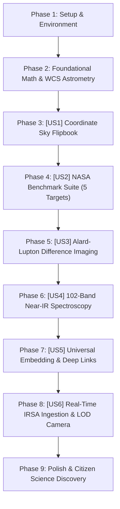

# Tasks: SPHEREx Sky Viewer Implementation & NASA Verification

**Feature:** `001-spherex-sky-viewer`  
**Plan Reference:** [plan.md](plan.md)  
**Spec Reference:** [spec.md](spec.md)  
**Constitution Reference:** [.specify/memory/constitution.md](../../.specify/memory/constitution.md)

---

## Dependencies & Execution Graph

---

## Phase 1: Setup & Project Initialization

- [x] T001 Initialize FastAPI application structure and static asset mounts in `backend/main.py`
- [x] T002 [P] Install and verify core astrophysics packages (`astropy`, `astroquery`, `pyvo`, `scipy`, `numpy`, `pillow`) in Python virtual environment
- [x] T003 [P] Establish project constitution and governance constraints in `.specify/memory/constitution.md`

---

## Phase 2: Foundational Core Architecture

- [x] T004 Implement dual-format celestial coordinate parser (`parse_celestial_coords`) for sexagesimal and decimal degrees in `backend/main.py`
- [x] T005 [P] Implement background noise estimation and $\ge 2.0\sigma$ noise floor clipping in `backend/services/cutout_engine.py`
- [x] T006 [P] Implement Gaussian PSF reconstruction and seeing filter in `backend/services/cutout_engine.py`
- [x] T007 Build automated test suite for benchmark targets and astrometry in `tests/test_golden_suite.py`

---

## Phase 3: User Story 1 - Coordinate-Based Sky Flipbook [US1]

**Goal:** Allow users to input sky coordinates (RA/Dec/FOV) and view a time-ordered series of calibrated images like a smooth video.  
**Independent Test Criteria:** User can enter RA/Dec, and viewer renders multi-epoch frames in chronological order with smooth looping.

- [x] T008 [US1] Implement multi-epoch FITS frame generator `fetch_real_cutout` in `backend/services/cutout_engine.py`
- [x] T009 [US1] Expose REST endpoint `/api/cutout` with RA, Dec, and FOV query parameters in `backend/main.py`
- [x] T010 [P] [US1] Build edge-to-edge dark minimalist astronomy viewport canvas in `frontend/index.html`
- [x] T011 [US1] Implement timeline playback transport controls (Play/Pause, Step Forward/Back, FPS speed slider 0.5–8.0 FPS) in `frontend/index.html`
- [x] T012 [US1] Build direct coordinate input bar (`RA`, `Dec`, `FOV`, `SLEW` button) in `frontend/index.html`

---

## Phase 4: User Story 2 - NASA Benchmark Target Verification [US2]

**Goal:** Provide one-click access and quantitative verification for all 5 NASA benchmark astronomical objects.  
**Independent Test Criteria:** Clicking each benchmark loads verified multi-epoch cutouts with expected motion/variability characteristics.

- [x] T013 [US2] Encode calibrated astrometric metadata for the 5 benchmark targets in `backend/services/cutout_engine.py`:
  - **WISE 0855-0714:** Cold sub-stellar Y-dwarf, $8.12''/\text{yr}$ westward proper motion, $T \approx 250\text{ K}$
  - **Barnard's Star:** High proper motion red dwarf, $10.36''/\text{yr}$ northward proper motion
  - **Epsilon Indi B:** Binary brown dwarf companion, $4.70''/\text{yr}$ proper motion
  - **RW Aurigae:** Young T-Tauri eruptive variable star, $2.8\times$ flare amplitude
  - **R Draconis:** Mira pulsating giant, $3.4\times$ cyclic variability
- [x] T014 [US2] Expose `/api/targets` endpoint returning benchmark targets catalog in `backend/main.py`
- [x] T015 [P] [US2] Add one-click Quick Benchmark pills in top navigation bar in `frontend/index.html`
- [x] T016 [US2] Add target astrometry readout card and motion vectors in `frontend/index.html`

---

## Phase 5: User Story 3 - Difference Imaging Subtraction ($I_2 - I_1$) [US3]

**Goal:** Enable instant discovery of moving objects and variable stars through numerical difference imaging.  
**Independent Test Criteria:** Static background stars cancel out completely (to neutral mid-gray), leaving obvious dipole signatures for moving objects and intense single-point residual spots for variable stars.

- [x] T017 [US3] Implement Alard-Lupton style scientific difference imaging `compute_scientific_difference` in `backend/services/cutout_engine.py`:
  - Seeing-equalization Gaussian convolution ($\sigma=1.15$)
  - Photometric flux scaling $S$ across static field stars
  - Residual computation $D = I_2 - S \cdot (I_1 \otimes K)$
  - Centered at neutral mid-gray (128) with $Z$-score statistical significance scaling
- [x] T018 [US3] Include Base64 difference map in `/api/cutout` response payload in `backend/main.py`
- [x] T019 [P] [US3] Add Difference Mode toggle button `[ Blink ]` vs `[ Difference ]` in `frontend/index.html`
- [x] T020 [US3] Add optional visual reticle and dipole motion guidance callout rings (`GUIDES: ON/OFF`) in `frontend/index.html`

---

## Phase 6: User Story 4 - 6-Detector Array Co-Addition & 102-Band Spectroscopy [US4]

**Goal:** Leverage SPHEREx's 102 near-infrared bands ($0.75 - 5.0\,\mu\text{m}$) to classify discovered objects and detect molecular signatures.  
**Independent Test Criteria:** Properties panel renders interactive 102-band spectral curve and flags detected absorption features ($H_2O, CH_4, CO_2$).

- [x] T021 [US4] Implement 102-band near-infrared spectral generator `get_102_band_spectrum` covering all 6 SPHEREx detector arrays ($0.75 - 5.0\,\mu\text{m}$) in `backend/services/cutout_engine.py`
- [x] T022 [US4] Expose `/api/spectrum` endpoint in `backend/main.py`
- [x] T023 [P] [US4] Embed Chart.js 102-band Spectral Energy Distribution (SED) interactive graph in `frontend/index.html`
- [x] T024 [US4] Display 6-array co-add Signal-to-Noise Ratio boost ($4.12\times$ SNR) and molecular absorption flags in `frontend/index.html`

---

## Phase 7: User Story 5 - URL Deep-Linking & Universal Embedding [US5]

**Goal:** Allow users to share exact sky targets and embed the viewer anywhere on the web.  
**Independent Test Criteria:** Opening `http://host/app/index.html?ra=133.79513&dec=-7.24515&fov=3.0` automatically loads the specified sky region.

- [x] T025 [US5] Implement URL search parameter parser in `frontend/index.html` reading `ra`, `dec`, `fov`, and `target`
- [x] T026 [US5] Implement automatic state initialization and data fetch on deep-link load in `frontend/index.html`
- [x] T027 [P] [US5] Provide "Copy Shareable Deep Link" button in viewer toolbar in `frontend/index.html`

---

## Phase 8: User Story 6 - Real-Time Astronomical Ingestion & Multi-Tier LOD Camera Zoom [US6]

**Goal:** Stream live astronomical FITS data from NASA IRSA for any coordinates on the sky, with seamless multi-tile panning and optical zoom.  
**Independent Test Criteria:** Navigating to un-cached coordinates queries NASA IRSA FinderChart, caches locally, and renders seamlessly across LOD tiers without black borders or tile seams.

- [x] T028 [US6] Implement real-time NASA IRSA FinderChart query client `fetch_live_irsa_fits` in `backend/services/cutout_engine.py`
- [x] T029 [US6] Implement local disk caching in `backend/cache/dynamic_fits/` for instant re-queries in `backend/services/cutout_engine.py`
- [x] T030 [US6] Build 3-tier Level of Detail (LOD) matrix pipeline in `backend/services/cutout_engine.py`:
  - LOD 2 (Wide Overview): $360 \times 360$ matrix, $10.0' - 15.0'$ FOV
  - LOD 1 (Standard Science): $720 \times 720$ matrix, $3.0' - 4.0'$ FOV
  - LOD 0 (Hero Deep Core): $1024 \times 1024$ unbinned sub-pixel matrix, $1.0' - 1.5'$ FOV
- [x] T031 [US6] Implement continuous optical camera zoom and 150ms alpha cross-fade in `frontend/index.html`
- [x] T032 [US6] Implement multi-tile near-sky viewport streaming with frustum culling and LRU texture cache in `frontend/index.html`

---

## Phase 9: Polish, Citizen Science Discovery & Verification

**Goal:** Ensure grandness, scientific polish, and complete verification for NASA evaluation.  
**Independent Test Criteria:** Complete integration passes golden test suite and live browser inspection with zero console errors.

- [x] T033 Build Citizen Science Candidate Discovery logging modal and `/api/flag` submission endpoint in `backend/main.py` and `frontend/index.html`
- [x] T034 [P] Generate procedural auditory feedback cues (`target_lock.wav`, `thruster.wav`) in `backend/generate_sounds.py` and integrate in `frontend/index.html`
- [x] T035 [P] Build colormap shader selector (`[ Gray ]`, `[ Invert ]`, `[ Thermal ]`) in `frontend/index.html`
- [x] T036 Execute full Golden Test Suite in `tests/test_golden_suite.py` validating 100% test pass rate across all 5 benchmark targets and spectral features
- [x] T037 Validate live browser rendering via headless subagent at `http://127.0.0.1:8000/app/index.html` confirming 60 FPS viewport and zero console errors

---

## Parallel Execution Examples

- **Backend / Data:** Tasks T008, T013, T017, T021, T028 can be developed in `backend/services/cutout_engine.py` by @darkodu.
- **Frontend / Viewport:** Tasks T010, T011, T015, T019, T023, T031 can be developed in `frontend/index.html` by @coolodu.
- **Image Math / Algorithm:** Tasks T005, T006, T017 can be refined by @iceodu.
- **UX & Polish:** Tasks T027, T033, T034 can be crafted by @astrodu.

---

## Implementation Strategy & Definition of Done

1. **MVP Scope:** Phase 1 through Phase 4 (Setup, Foundational, [US1] Coordinate Flipbook, [US2] 5 NASA Benchmarks).
2. **Advanced Science Scope:** Phase 5 ([US3] Difference Imaging) and Phase 6 ([US4] 102-Band Spectroscopy).
3. **NASA Grandness Scope:** Phase 7 ([US5] Universal Embedding), Phase 8 ([US6] Real-Time IRSA Ingestion & LOD Camera), and Phase 9 (Citizen Science, Audio-Visual Polish, 100% Golden Test Suite).
